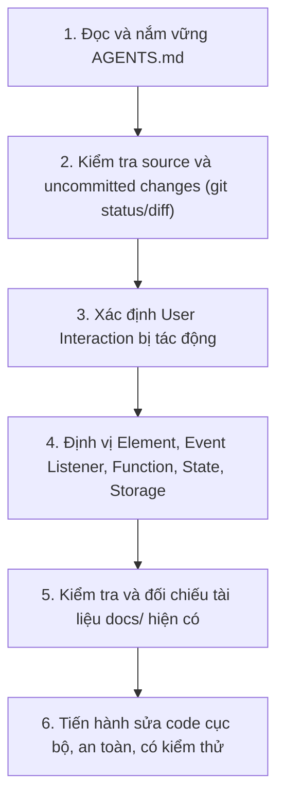

# AGENTS.md — Quy tắc làm việc & Chuẩn mực phát triển QuestDay Todo List

> **Tài liệu định hướng và quy chuẩn bắt buộc dành cho AI Coding Agent và Nhà phát triển.**  
> Mọi tương tác, phân tích, viết tài liệu và can thiệp mã nguồn trong repository này đều phải tuân thủ nghiêm ngặt các nguyên tắc dưới đây.

---

## 1. Bối cảnh dự án (Project Context)

- **Tên sản phẩm:** **QuestDay Todo List**
- **Nguồn gốc:** Repository được kế thừa/clone từ **Quest Log** của tác giả **Ankankun** (giữ nguyên giấy phép MIT License © 2025 Ankankun).
- **Mục tiêu sản phẩm:** Ứng dụng quản lý công việc cá nhân (Todo List) kết hợp cơ chế RPG / Gamification.
  - Người dùng tạo, theo dõi, chỉnh sửa và hoàn thành Quest.
  - Hoàn thành nhiệm vụ nhận XP, tăng Level, tạo động lực làm việc hằng ngày.
  - Lộ trình mở rộng trong tương lai: Daily Planning, History, Streak, Recurring Quest, Backup/Export dữ liệu.
  - Tôn trọng phong cách retro notebook RPG nguyên bản; mọi nâng cấp giao diện hay chức năng phải có chủ đích rõ ràng.

### Ràng buộc kỹ thuật cốt lõi (Strict Technical Constraints)
1. **Công nghệ nền tảng:** 100% **Vanilla HTML, CSS và JavaScript thuần**. Tuyệt đối không build step, không bundler, không TypeScript, không chuyển sang React, Vue, Angular hay bất kỳ framework nào.
2. **Lưu trữ dữ liệu:** **`localStorage` của trình duyệt** là cơ chế lưu trữ chính duy nhất.
3. **Không Backend:** Không triển khai backend server, database bên ngoài, hoặc hệ thống authentication.
4. **Không tích hợp AI:** Không gọi OpenAI, Gemini hay các API AI bên ngoài vào source code runtime.
5. **Hạn chế thư viện:** Không tùy tiện thêm thư viện bên ngoài (kể cả thư viện xử lý ngày tháng như moment, date-fns hay UI components). Chỉ sử dụng khi có yêu cầu và thảo luận rõ ràng.
6. **Thay đổi cục bộ (Local Modifications):** Không refactor toàn bộ source code khi chỉ cần can thiệp cục bộ một hàm hoặc một luồng sự kiện.
7. **Bảo toàn dữ liệu người dùng:** Không được tự ý thay đổi, xóa bỏ hoặc làm gãy cấu trúc các khóa `localStorage` hiện tại (`questLog_tasks`, `questLog_xp`, `questLog_level`).
8. **Bảo toàn bản quyền:** Giữ nguyên thông tin tác giả gốc và License theo quy định của MIT License.

---

## 2. Mục tiêu học tập hàng đầu: User-Interaction-First Execution Flow

Dự án này phục vụ song song hai mục tiêu: phát triển sản phẩm chất lượng và đào tạo/học tập kỹ thuật frontend chuyên sâu.

> [!IMPORTANT]
> **Ưu tiên cao nhất:** Hiểu và giải thích được **Execution Flow** từ góc nhìn **tương tác của người dùng**.  
> Tuyệt đối không tổ chức tài liệu học tập theo dạng liệt kê file, class hay từng hàm đơn lẻ.

Khi tiếp cận bất kỳ tính năng nào, câu hỏi xuất phát điểm luôn là:  
> **"Khi người dùng thực hiện hành động X trên giao diện, hệ thống thực sự chạy qua những đâu?"**

Mỗi tương tác người dùng phải được phân tích minh bạch qua chuỗi 10 bước sau:
1. **UI Element:** Người dùng thao tác trên thành phần giao diện cụ thể nào (selector, button, input...)?
2. **DOM Event:** Sự kiện trình duyệt nào được phát sinh (`click`, `submit`, `dblclick`, `keydown`...)?
3. **File & Event Handler:** File nào và event listener nào tiếp nhận sự kiện đó?
4. **Call Stack / Function Sequence:** Những hàm nào được kích hoạt, theo **đúng thứ tự thực tế** mà JavaScript runtime thực thi?
5. **State Mutation:** Biến trạng thái toàn cục/cục bộ trong bộ nhớ JavaScript (`tasks`, `xp`, `level`...) thay đổi ra sao?
6. **Persistence (LocalStorage):** LocalStorage được đọc/ghi ở thời điểm nào, khóa nào bị tác động, dữ liệu được serialize/deserialize ra sao?
7. **DOM Render / Mutation:** Cấu trúc DOM nào được dựng mới hoặc cập nhật (`render()`, class toggle, animation)?
8. **Visual Feedback:** Kết quả cụ thể cuối cùng người dùng nhìn thấy trên màn hình là gì?
9. **Branching & Edge Cases:** Nhánh điều kiện nào được kiểm tra (validation, duplicate, empty input, overflow XP)?
10. **Debug & Verify:** Làm thế nào để đặt breakpoint, theo dõi biến và xác minh luồng thực thi trong Developer Tools?

---

## 3. Quy trình bắt buộc trước khi can thiệp mã nguồn (Workflow Before Coding)

Trước khi thực hiện bất kỳ thay đổi nào trong code, AI Agent phải tuần tự thực hiện các bước:



### Các nguyên tắc hành động:
- **Không đoán mò:** Không bao giờ giả định tên file, tên biến, tên hàm, cấu trúc object hay hành vi runtime mà chưa đọc mã nguồn thực tế.
- **Không tự mở rộng scope:** Chỉ làm đúng phạm vi task được giao; không tự ý thêm các tính năng "tiện ích" ngoài lề.
- **Can thiệp tối thiểu:** Ưu tiên thay đổi nhỏ gọn, dễ review, dễ kiểm tra, hài hòa với kiến trúc hiện có của dự án.
- **Tôn trọng thay đổi của người dùng:** Tuyệt đối không ghi đè, hoàn tác hoặc xóa bỏ các thay đổi uncommitted của người dùng nếu chưa được xác nhận.

---

## 4. Chuẩn mực tài liệu hóa (User-Interaction-First Documentation)

Tài liệu học tập và phân tích tương tác được đặt tập trung trong thư mục `docs/`:
- [`docs/USER-FLOWS.md`](docs/USER-FLOWS.md): Bảng mục lục tổng hợp tất cả các User Flow, có mã định danh ổn định (**F00, F01, F02...**).
- `docs/flows/`: Chứa các file Markdown chi tiết cho từng nhóm tương tác.

### Các tài liệu khởi đầu:
- `docs/flows/00-app-startup.md` (F00: Khởi tạo ứng dụng & nạp dữ liệu)
- `docs/flows/01-quest-management.md` (F01: Thêm, xóa, hoàn thành, sửa, đánh dấu sao Quest)
- `docs/flows/02-xp-level.md` (F02: Cơ chế tích lũy XP, tính toán cấp độ, lên cấp)

> [!WARNING]
> - Chỉ tạo file flow khi tính năng tương ứng đã tồn tại trong mã nguồn. Không viết tài liệu cho tính năng tưởng tượng hoặc chưa được triển khai.
> - Không tạo file tài liệu riêng lẻ cho từng hàm JavaScript.

### Cấu trúc 9 phần bắt buộc cho mỗi file User Flow (`docs/flows/*.md`)

Mỗi tài liệu tương tác bắt buộc phải tuân theo cấu trúc chuẩn mực từ **A** đến **I**:

```markdown
# [Mã Flow] Tên Luồng Tương Tác

## A. User Scenario
- **Bối cảnh & Vị trí:** Người dùng đang ở màn hình nào?
- **Thao tác:** Người dùng thực hiện hành động cụ thể gì?
- **Tiền điều kiện:** Trạng thái trước khi thao tác (VD: input có chữ, danh sách rỗng...).
- **Kết quả kỳ vọng:** Người dùng mong đợi điều gì xảy ra?

## B. Actual Execution Flow
Mô tả trực quan chuỗi thực thi theo đúng thứ tự thực tế trong source:
Thao tác người dùng 
  → DOM Event 
  → Event Listener / Handler 
  → Business Logic 
  → State Mutation 
  → LocalStorage Persistence 
  → DOM Render / UI Update 
  → Phản hồi giao diện (Visual Feedback)

## C. Source Code Walkthrough
- Đi qua từng bước với liên kết Markdown tương đối (relative links) tới file source code.
- Nêu rõ tên element, event name, tên hàm xử lý.
- Thứ tự hàm gọi hàm (Caller -> Callee).
- Dữ liệu input/output và biến trạng thái then chốt.
- Giải thích mục đích kỹ thuật của từng bước.

## D. State and LocalStorage
- **In-Memory State:** Giá trị biến trạng thái trước và sau tương tác.
- **Storage Keys:** Các khóa LocalStorage liên quan (`questLog_tasks`, `questLog_xp`...).
- **Thời điểm đọc/ghi:** Nơi gọi `JSON.stringify()` / `JSON.parse()`.
- **Hành vi sau khi Reload:** Dữ liệu có được giữ nguyên khi F5 hoặc mở lại tab?
- **Rủi ro mất dữ liệu:** Trường hợp nào dữ liệu có thể không được lưu (lỗi parse, quota exceeded...)?

## E. UI Update
- Các node DOM bị thêm, sửa, xóa, hoặc đổi class CSS.
- Hàm render nào được triệu gọi (`render()`, `updateXPUI()`, `updateBindingHoles()`).
- Phản hồi trực quan (animation flash, floating star, ribbon, modal...).

## F. Edge Cases & Known Behaviors
- Input không hợp lệ (chuỗi rỗng, chỉ có khoảng trắng, ký tự đặc biệt).
- Thao tác trùng lặp hoặc spam click liên tục.
- Dữ liệu LocalStorage bị rỗng, null hoặc sai định dạng JSON.
- Phân biệt rõ: **Hành vi thực tế hiện tại của code** và **Hành vi mong muốn lý tưởng**. Không tự nhận bug đã sửa nếu code chưa xử lý.

## G. Debug Guide
- Điểm bắt đầu trace luồng trong trình duyệt.
- Tên hàm hoặc dòng code nên đặt Breakpoint trong DevTools Sources.
- Danh sách các biến cần đưa vào Watch Expressions.
- Các nguyên nhân thường gặp dẫn đến lỗi luồng này.

## H. Manual Test Steps
Các bước kiểm thử thủ công từng bước trên trình duyệt kèm kết quả kỳ vọng (Expected Output) tương ứng.

## I. Learning Check
2–3 câu hỏi ôn tập trọng tâm giúp người học tự kiểm tra mức độ nắm bắt về luồng xử lý, state mutation hoặc cơ chế bẫy lỗi.
```

---

## 5. Quy chuẩn liên kết mã nguồn (Mandatory Markdown Relative Links)

Tất cả các liên kết trong tài liệu nội bộ phải sử dụng **Markdown Relative Link** được tính toán chính xác từ vị trí của file tài liệu đang viết:

- Từ `docs/flows/01-quest-management.md`:
  - `[index.html](../../index.html)`
  - `[script.js](../../script.js)`
  - `[style.css](../../style.css)`
- Từ `docs/USER-FLOWS.md`:
  - `[F01: Quest Management](flows/01-quest-management.md)`
- Từ `AGENTS.md` ở root:
  - `[script.js](script.js)`
  - `[index.html](index.html)`
  - `[docs/USER-FLOWS.md](docs/USER-FLOWS.md)`

### Yêu cầu nghiêm ngặt:
1. **Phải tồn tại:** File đích được trỏ tới phải thực sự tồn tại trong repository.
2. **Khả dụng trong preview:** Link phải click mở được trực tiếp trong VS Code Markdown Preview.
3. **Tuyệt đối không dùng đường dẫn tuyệt đối:** Cấm dùng đường dẫn tuyệt đối máy cá nhân (ví dụ: `C:\Users\...` hoặc `D:\...`).
4. **Không dùng link GitHub bên ngoài:** Đối với file local trong repository, không dùng đường dẫn URL mạng `https://github.com/...`.
5. **Không để đường dẫn plain text:** Phải format dưới dạng Markdown link `[Tên hiển thị](đường_dẫn_tương_đối)`.
6. **Định danh hàm rõ ràng:** Ghi tên hàm cụ thể bên cạnh liên kết (ví dụ: `[script.js](../../script.js) -> renderItem()`).
7. **Kiểm tra sau khi tạo:** Luôn kiểm tra lại tính chính xác của toàn bộ relative link sau khi tạo hoặc cập nhật tài liệu.

---

## 6. Quy tắc bảo trì tài liệu (Rules for Maintaining Documentation)

Sau bất kỳ thay đổi nào liên quan đến logic nghiệp vụ, xử lý sự kiện hoặc cấu trúc dữ liệu:
1. **Xác định phạm vi ảnh hưởng:** Liệt kê toàn bộ các User Flow bị tác động.
2. **Cập nhật đồng bộ:** Cập nhật ngay các file flow liên quan trong `docs/flows/`.
3. **Đồng bộ Index:** Cập nhật `docs/USER-FLOWS.md` nếu xuất hiện flow mới hoặc thay đổi mã định danh.
4. **Khớp nối thực tế:** Đảm bảo tên hàm, tham số, cấu trúc object và thứ tự thực thi trong tài liệu phản ánh chính xác 100% source code mới nhất.
5. **Tuyệt đối không để logic cũ tồn đọng:** Xóa bỏ hoặc sửa đổi các mô tả luồng đã bị thay thế; không để người học đọc phải tài liệu lỗi thời.
6. **Không tạo tài liệu rác:** Nếu chỉ thay đổi màu sắc, font chữ, hoặc tinh chỉnh CSS không làm thay đổi interaction flow thì **không tạo thêm tài liệu học mới**.

---

## 7. Quy tắc lập trình & Xử lý dữ liệu (Coding and Data Rules)

- **Đơn giản & Rõ ràng (Simplicity First):** Viết code tường minh, dễ đọc, hạn chế tối đa các tầng trừu tượng (abstraction) không cần thiết. Không tạo design pattern hay framework nội bộ phức tạp chỉ để bọc vài hàm cơ bản.
- **Bảo toàn hành vi cũ (Backward Compatibility):** Không làm gián đoạn các tính năng đang chạy ổn định trừ khi task yêu cầu cải tiến.
- **Bảo toàn dữ liệu LocalStorage:**
  - Giữ nguyên các khóa hiện tại: `questLog_tasks`, `questLog_xp`, `questLog_level`.
  - Nếu thay đổi model của task (thêm trường mới), phải cung cấp giá trị mặc định cho dữ liệu cũ đọc từ LocalStorage, tuyệt đối không làm crash app hoặc xóa trắng danh sách nhiệm vụ của người dùng.
- **Xử lý Thời gian & Ngày tháng chuẩn mực:**
  - Không nạp thêm thư viện ngoài (như date-fns, moment, dayjs) khi `Date` API của JavaScript giải quyết được.
  - Khi xử lý dueDate, Daily Reset, Streak: Luôn tính toán dựa trên ngày địa phương (Local Date), xử lý múi giờ và mốc giao thoa ngày mới (00:00:00) một cách nhất quán, tránh lỗi lệch ngày do múi giờ UTC.
- **An toàn phiên bản (Git Safety):**
  - Không tự ý chạy `git push`, `git push --force`.
  - Không commit hoặc stash đè lên các thay đổi đang có trong working directory của người dùng.

---

## 8. Quy tắc kiểm thử (Testing Rules)

Sau khi hoàn thành sửa đổi mã nguồn:
1. **Kiểm tra tính năng mới:** Đảm bảo chức năng được yêu cầu hoạt động đúng.
2. **Kiểm tra hồi quy (Regression Test):** Kiểm tra lại các luồng tương tác lân cận xem có bị ảnh hưởng tiêu cực không.
3. **Kiểm tra Persistence:** Tải lại trang (F5 / Hard Reload) để xác nhận dữ liệu trong LocalStorage được lưu và nạp lại chính xác.
4. **Kiểm tra trường hợp biên (Edge Cases):** Chuỗi rỗng, ký tự khoảng trắng, thao tác liên tiếp, ngày trong quá khứ/tương lai.
5. **Minh bạch kết quả kiểm thử:**
   - Không bao giờ báo cáo "đã test thành công" nếu chưa thực sự chạy thử hoặc kiểm tra code.
   - Nêu rõ phần nào đã được kiểm tra bằng code/script, và phần nào cần người dùng kiểm tra thủ công trực tiếp trên trình duyệt.

---

## 9. Định dạng Báo cáo Bàn giao Bắt buộc (Mandatory Final Handoff Format)

Sau khi hoàn tất mỗi task, AI Agent bắt buộc phải tổng kết bằng **tiếng Việt**, súc tích nhưng đầy đủ thông tin, tuân theo đúng cấu trúc 6 mục dưới đây:

### 1. Đã thực hiện
- Tóm tắt các thay đổi thực tế đã làm trong task.
- Danh sách file đã tạo hoặc chỉnh sửa (kèm Markdown relative link tới file).

### 2. User Interaction Flow
- Người dùng thực hiện thao tác gì trên UI?
- DOM Event nào được kích hoạt?
- Những hàm nào được thực thi, theo đúng thứ tự gọi thực tế?
- Biến trạng thái (State), dữ liệu lưu trữ (LocalStorage) và giao diện (DOM) thay đổi thế nào?

### 3. Key Functions
- Chọn lọc 3–5 hàm quan trọng nhất liên quan đến task.
- Nêu rõ vai trò, input/output và kèm link tới file source.

### 4. Testing
- Liệt kê các kịch bản đã kiểm tra và kết quả thực tế.
- Nêu rõ những trường hợp chưa thể xác minh tự động và hướng dẫn người dùng tự kiểm tra trên trình duyệt.

### 5. Learning Handoff
- Link tới tài liệu User Flow tương ứng trong thư mục `docs/`.
- 2–3 câu hỏi tự kiểm tra kiến thức về luồng tương tác vừa học.
- 1 bài thực hành debug nhỏ (gợi ý đặt breakpoint tại đâu để quan sát sự thay đổi).

### 6. Limitations
- Những điểm chưa tối ưu, các trường hợp biên chưa xử lý hoặc các việc cần tiếp tục ở task tiếp theo.

---

## 10. Tính toàn vẹn của Triển khai & Tài liệu (Integrity Policy)

- **Phản ánh trung thực mã nguồn:** Mọi sơ đồ, walkthrough và giải thích phải dựa trên source code thực tế.
- **Không ngụy tạo:** Tuyệt đối không bịa đặt tên hàm, tên biến, đường dẫn file hoặc kết quả kiểm thử.
- **Không bóp méo luồng thực thi:** Không thay đổi thứ tự gọi hàm trong tài liệu chỉ để sơ đồ trông "đẹp hơn" hoặc "hợp lý hơn" nếu thực tế code chạy khác.
- **Phân biệt rạch ròi 3 tầng:**
  - **In-Memory State** (Biến JavaScript trong RAM).
  - **Persistent Storage** (Dữ liệu ghi vào LocalStorage).
  - **DOM / UI Presentation** (Các phần tử hiển thị trên màn hình).  
  *Tuyệt đối không đánh đồng 3 khái niệm này với nhau.*
- **Xử lý Bug ngoài phạm vi:** Nếu phát hiện lỗi có sẵn trong source code gốc nằm ngoài phạm vi task hiện tại, phải ghi nhận vào mục Limitations và báo cáo cho người dùng trước khi quyết định can thiệp.

