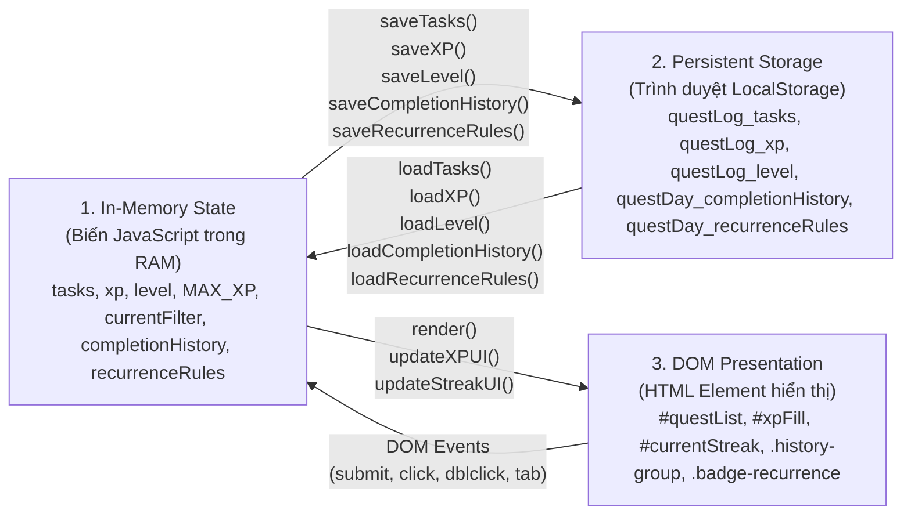

# Mục Lục Luồng Tương Tác Người Dùng (User Flows Directory)

> **Dự án: QuestDay Todo List**  
> **Nguyên tắc cốt lõi:** User-Interaction-First. Mọi tài liệu phân tích đều xuất phát từ hành động cụ thể của người dùng trên giao diện để lần theo toàn bộ chuỗi thực thi mã nguồn.

---

## 🗺️ Bản đồ tổng hợp các User Flow (Flow Inventory)

Bảng dưới đây thống kê toàn bộ các luồng tương tác thực tế đang có trong mã nguồn (Existing) và các tính năng dự kiến phát triển trong lộ trình tiếp theo (Planned).

| Mã Flow | Hành động của Người dùng | Mô tả tóm tắt luồng thực thi | Tài liệu chi tiết | Trạng thái |
| :---: | :--- | :--- | :--- | :---: |
| **F00** | Mở trang hoặc F5 tải lại ứng dụng | Nạp tasks, xp, level và completion history; tính toán chuỗi Daily Streak; cập nhật thanh tiến trình và render view hiện tại. | [00-app-startup.md](flows/00-app-startup.md) | **Existing** |
| **F01** | Tạo Quest mới (cơ bản) | Nhập tên nhiệm vụ, nhấn Submit/Enter: validate input, tạo task object, lưu LocalStorage, cộng 5 XP, render lại DOM. | [01-quest-management.md](flows/01-quest-management.md#f01-người-dùng-tạo-quest-mới) | **Existing** |
| **F02** | Chỉnh sửa tên Quest trực tiếp | Nháy đúp (double-click) vào text nhiệm vụ để mở ô input tại chỗ, nhấn Enter hoặc click ngoài để lưu, nhấn Escape để hủy. | [01-quest-management.md](flows/01-quest-management.md#f02-người-dùng-sửa-quest-inline-editing) | **Existing** |
| **F03** | Hoàn thành / Hủy hoàn thành Quest | Nhấn checkbox: ghi `completedAt`, tạo/hoàn tác history event, thưởng 10 XP lần đầu, cập nhật Streak, lưu LocalStorage và render. | [01-quest-management.md](flows/01-quest-management.md#f03-người-dùng-hoàn-thành--hủy-hoàn-thành-quest) | **Existing (Updated M02)** |
| **F04** | Xóa Quest khỏi danh sách | Nhấn nút `✕` trên Quest: xóa task khỏi mảng State nhưng **bảo tồn lịch sử hoàn thành** trong `completionHistory` nếu đã hoàn thành. | [01-quest-management.md](flows/01-quest-management.md#f04-người-dùng-xóa-quest) | **Existing (Updated M02)** |
| **F05** | Đánh dấu yêu thích / quan trọng | Nhấn nút ngôi sao: đảo cờ `favorite`, lưu LocalStorage, sắp xếp lại đưa các Quest yêu thích lên trên cùng. | [01-quest-management.md](flows/01-quest-management.md#f05-người-dùng-đánh-dấu-yêu-thích-star) | **Existing** |
| **F06** | Nhận XP, tăng Level & cập nhật tiến trình | Kích hoạt khi thêm quest (+5) hoặc hoàn thành lần đầu (+10): kiểm tra ngưỡng rollover, hiển thị số XP còn thiếu để lên cấp. | [02-xp-level.md](flows/02-xp-level.md) | **Existing (Updated M02)** |
| **F07** | Chuyển đổi chế độ xem (Switch View) | Nhấn tab Today / Upcoming / Overdue / All: chuyển `currentFilter`, cập nhật badge số lượng, lọc danh sách từ mảng State và render. | [03-daily-planning.md](flows/03-daily-planning.md#f07-người-dùng-chuyển-đổi-chế-độ-xem-switch-daily-view) | **Existing (M01)** |
| **F08** | Tạo Quest có kế hoạch (Scheduled Quest) | Chọn ngày thực hiện `plannedDate` và hạn chót `dueDate` độc lập: lưu task có ngày, tự chuyển view phù hợp, thưởng +5 XP. | [03-daily-planning.md](flows/03-daily-planning.md#f08-người-dùng-tạo-quest-có-kế-hoạch-create-scheduled-quest) | **Existing (M01)** |
| **F09** | Thay đổi ngày / Dời lịch (Reschedule) | Nhấn icon lịch trên Quest: mở form chỉnh ngày inline, hỗ trợ Clear/Cancel/Save ngày kế hoạch và deadline mà không thưởng thêm XP. | [03-daily-planning.md](flows/03-daily-planning.md#f09-người-dùng-thay-đổi-ngày--dời-lịch-reschedule-quest) | **Existing (M01)** |
| **F10** | Quay lại vào ngày mới (New Day & Rollover) | Mở lại app hoặc focus cửa sổ ngày hôm sau: tự động phát hiện mốc nửa đêm, hiển thị việc tồn đọng dưới dạng Carry-over mà không sửa ngày gốc. | [03-daily-planning.md](flows/03-daily-planning.md#f10-người-dùng-quay-lại-vào-ngày-mới-new-day--rollover) | **Existing (M01)** |
| **F11** | Xem Lịch sử hoàn thành (Open History) | Nhấn tab History: hiển thị danh sách nhật ký hoàn thành gom nhóm theo từng ngày thực tế, chế độ chỉ đọc (Read-Only) an toàn. | [04-history-streak.md](flows/04-history-streak.md#f11-người-dùng-xem-lịch-sử-hoàn-thành-open-quest-history) | **Existing (M02)** |
| **F12** | Theo dõi chuỗi ngày liên tục (Daily Streak) | Tự động tính toán Current Streak, Best Streak và số quest xong hôm nay dựa trên tập ngày hoàn thành hợp lệ (không bị hoàn tác). | [04-history-streak.md](flows/04-history-streak.md#f12-người-dùng-theo-dõi-chuỗi-ngày-streak-view-daily-streak) | **Existing (M02)** |
| **F13** | Tạo Quest lặp lại (Create Recurring Quest) | Chọn chu kỳ Daily hoặc Weekly, thiết lập ngày bắt đầu và deadline tương đối, lưu quy tắc và phát sinh lượt đầu (+5 XP). | [05-recurring-quests.md](flows/05-recurring-quests.md#f13-người-dùng-tạo-quest-lặp-lại-create-recurring-quest) | **Existing (M03)** |
| **F14** | Tự động phát sinh lượt tiếp theo (Lazy Generation) | Tự động sinh lượt mới khi chuyển ngày hoặc mở lại app, bảo toàn offset hạn chót, ngăn ngập lụt bằng cơ chế Carry-over (+0 XP). | [05-recurring-quests.md](flows/05-recurring-quests.md#f14-tự-động-phát-sinh-lượt-nhiệm-vụ-tiếp-theo-lazy-occurrence-generation--carry-over) | **Existing (M03)** |
| **F15** | Dừng lặp nhiệm vụ (Stop Repeating Quest) | Nhấn nút `🚫` dừng lặp: vô hiệu hóa rule, chuyển badge sang `Stopped`, ẩn nút thao tác và ngăn phát sinh lượt trong tương lai. | [05-recurring-quests.md](flows/05-recurring-quests.md#f15-người-dùng-dừng-lặp-nhiệm-vụ-stop-repeating-quest) | **Existing (M03)** |
| **F16** | Xóa một lượt nhiệm vụ lặp (Delete Occurrence) | Nhấn nút `🗑`: chỉ xóa lượt hiện tại, bảo toàn quy tắc lặp và lịch sử hoàn thành trong quá khứ. | [05-recurring-quests.md](flows/05-recurring-quests.md#f16-người-dùng-xóa-một-lượt-nhiệm-vụ-lặp-delete-recurring-occurrence) | **Existing (M03)** |
| **F17** | Hoàn thành & Chốt an toàn hoàn tác (Undo Guard) | Nhận +10 XP khi hoàn thành lượt đầu; chốt an toàn ngăn chặn hoàn tác lượt cũ nếu đã tồn tại lượt mới phát sinh. | [05-recurring-quests.md](flows/05-recurring-quests.md#f17-hoàn-thành-lượt-nhiệm-vụ--chốt-an-toàn-hoàn-tác-complete-undo-guard--xp-rules) | **Existing (M03)** |
| **F18** | Xuất dữ liệu sao lưu (Export JSON Backup) | Trích xuất toàn bộ dữ liệu (tasks, XP, level, history, rules) thành file JSON chuẩn hóa lưu trữ offline. | [06-data-backup.md](flows/06-data-backup.md#f18-người-dùng-xuất-dữ-liệu-sao-lưu-export-json-backup) | **Existing (M04)** |
| **F19** | Nhập & Khôi phục dữ liệu (Import & Restore Data) | Đọc và kiểm thử file JSON, hiển thị modal tóm tắt xác nhận, khôi phục an toàn có cơ chế rollback. | [06-data-backup.md](flows/06-data-backup.md#f19-người-dùng-nhập--khôi-phục-dữ-liệu-import--restore-data) | **Existing (M04)** |

---

## 🏛️ Ba Tầng Kiến Trúc Bắt Buộc Phân Biệt

Khi học tập và debug ứng dụng này, **tuyệt đối không đánh đồng** ba tầng xử lý dữ liệu sau:

1. **In-Memory State:** Dữ liệu sống nằm trong RAM của JavaScript runtime trong phiên làm việc (`let tasks`, `let xp`, `let level`, `let currentFilter`, `let completionHistory`, `let recurrenceRules`). Chuỗi Streak là dữ liệu phái sinh (derived state) tính toán tức thời từ `completionHistory`.
2. **Persistent Storage:** Chuỗi JSON và số nguyên được ghi xuống ổ đĩa thông qua 5 khóa riêng biệt: `questLog_tasks`, `questLog_xp`, `questLog_level`, `questDay_completionHistory`, và `questDay_recurrenceRules`.
3. **DOM / UI Presentation:** Các phần tử HTML thực tế (`.quest-item`, `.history-item`, `.streak-card`, `.tab-badge`, `.badge-recurrence`) được dựng trên màn hình thông qua `render()`. Giao diện History hoàn toàn độc lập và không bị ảnh hưởng bởi event delegation của danh sách Todo.

---

## 🔍 Hướng dẫn học tập & Lần vết mã nguồn (How to Trace)

1. **Bước 1:** Chọn hành động bạn muốn khảo sát trong bảng trên (ví dụ: *F03 - Hoàn thành Quest* hoặc *F11 - Mở History*).
2. **Bước 2:** Mở tài liệu chi tiết tương ứng trong thư mục `flows/`.
3. **Bước 3:** Đọc kỹ **Mục C (Actual Execution Flow)** để nắm được bức tranh tổng quan từ tương tác của người dùng đến các hàm thực thi.
4. **Bước 4:** Mở source code chính [`script.js`](../script.js) và [`index.html`](../index.html) theo các đường dẫn tương đối.
5. **Bước 5:** Bật Developer Tools trên trình duyệt (`F12`), mở tab **Sources**, đặt Breakpoint tại các vị trí được hướng dẫn trong **Mục H (Debug Guide)** và thao tác thử trên màn hình để quan sát call stack và biến thay đổi theo thời gian thực.
