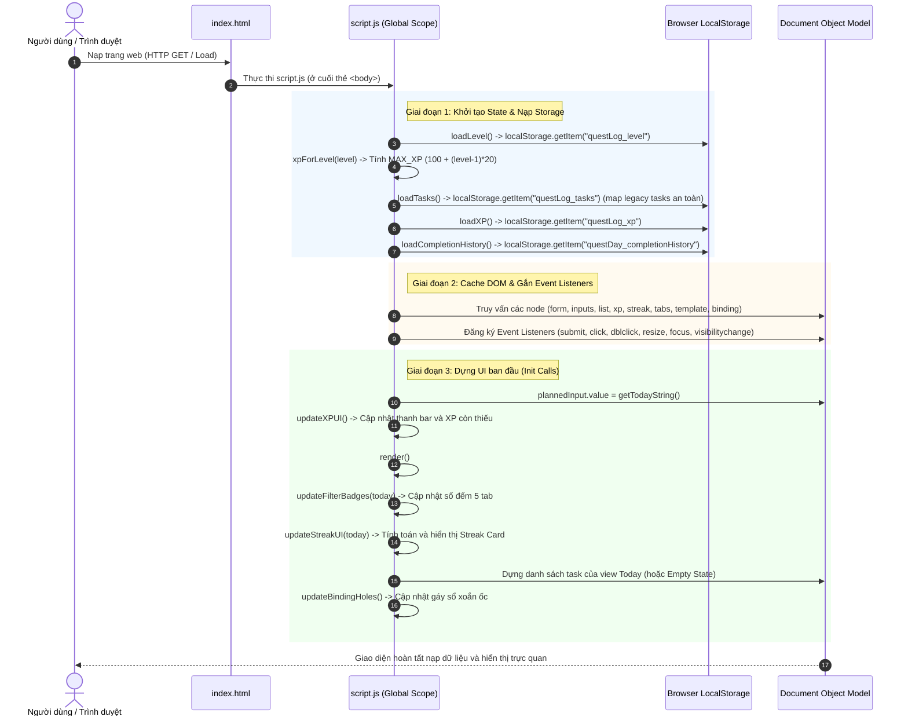

# [F00] Khởi Tạo Ứng Dụng & Nạp Dữ Liệu (App Startup & Data Initialization)

> **Mã Flow:** F00  
> **Tài liệu cha:** [USER-FLOWS.md](../USER-FLOWS.md)  
> **Mã nguồn liên quan:** [`script.js`](../../script.js) | [`index.html`](../../index.html) | [`style.css`](../../style.css)

---

## A. User Scenario

- **Bối cảnh & Vị trí:** Người dùng vừa mở trình duyệt và truy cập vào trang web ứng dụng hoặc nhấn phím `F5` / `Ctrl+R` để tải lại trang.
- **Thao tác:** Người dùng không cần thực hiện tương tác chuột hay bàn phím nào (hệ thống tự động kích hoạt khi nạp tài liệu HTML).
- **Tiền điều kiện:** 
  - Hoặc lần đầu tiên người dùng truy cập (`localStorage` chưa có dữ liệu, các key trả về `null`).
  - Hoặc người dùng đã có phiên làm việc trước đó (`localStorage` đang lưu trữ tasks, XP, Level, và lịch sử hoàn thành).
- **Kết quả kỳ vọng:** Giao diện cuốn sổ tay retro xuất hiện hoàn chỉnh:
  - Thanh tiến trình XP hiển thị đúng cấp độ, điểm số đã lưu và số XP còn thiếu để lên cấp.
  - Thẻ Streak Card hiển thị chuỗi ngày liên tiếp (`Current Streak`), kỷ lục (`Best Streak`) và số quest xong hôm nay.
  - Danh sách nhiệm vụ được lọc theo tab mặc định (`Today`).
  - Gáy sổ xoắn ốc (spiral holes) hiển thị số lượng lỗ bấm tương ứng với chiều cao của cuốn sổ.
  - Form nhập liệu sẵn sàng tiếp nhận văn bản với ngày dự định mặc định là hôm nay.

---

## B. Actual Execution Flow

Chuỗi thực thi thực tế diễn ra ngay khi trình duyệt phân tích xong file HTML và thực thi mã JavaScript:

---

## C. Source Code Walkthrough

Mã nguồn khởi động chạy tuần tự từ trên xuống dưới trong [`script.js`](../../script.js):

### 1. Khởi tạo hằng số & Nạp State vào bộ nhớ RAM
- **Dòng 1–16 trong [`script.js`](../../script.js):**
  - Định nghĩa 4 khóa LocalStorage:
    - `STORAGE_KEY_TASKS = "questLog_tasks"`
    - `STORAGE_KEY_XP = "questLog_xp"`
    - `STORAGE_KEY_LEVEL = "questLog_level"`
    - `STORAGE_KEY_HISTORY = "questDay_completionHistory"`
  - Gọi hàm [`loadLevel()`](../../script.js): Đọc `questLog_level` (mặc định 1).
  - Gọi hàm [`xpForLevel(level)`](../../script.js): Tính ngưỡng điểm `MAX_XP = 100 + (level - 1) * 20`.
  - Gọi hàm [`loadTasks()`](../../script.js): Nạp mảng tasks, chuẩn hóa các trường `plannedDate`, `dueDate`, `completedAt` (mặc định `null` cho legacy tasks) mà không ghi đè LocalStorage.
  - Gọi hàm [`loadXP()`](../../script.js): Nạp điểm XP trong cấp hiện tại (mặc định 0).
  - Gọi hàm [`loadCompletionHistory()`](../../script.js): Đọc `questDay_completionHistory`, bọc trong `try...catch`, trả về mảng rỗng `[]` nếu chưa có hoặc lỗi JSON.

### 2. Truy vấn và lưu tham chiếu DOM Nodes
- **Dòng 18–44 trong [`script.js`](../../script.js):**
  - Lưu tham chiếu các phần tử cố định: form nhập liệu, ô `plannedInput`, `dueInput`, `clearDatesBtn`, `xpFill`, `xpValue`, `xpRemaining`, `currentStreakEl`, `bestStreakEl`, `todayCompletedCountEl`, các badge tab số lượng.

### 3. Đăng ký các Event Listeners
- **Dòng 347–645 trong [`script.js`](../../script.js):**
  - Đăng ký `form submit`, `clearDatesBtn click`, `filterTabs click`, `listEl click` (Event delegation), `listEl dblclick`, `window resize`, `window focus`, `document visibilitychange`.

### 4. Triệu gọi chuỗi hàm dựng giao diện khởi đầu
- **Dòng 647–653 trong [`script.js`](../../script.js):**
  - Điền ngày hôm nay vào ô kế hoạch: `plannedInput.value = getTodayString()`.
  - `updateXPUI()`: Cập nhật độ rộng thanh progress và text `${needed} XP to Level ${level + 1}`.
  - `render()`:
    - `updateFilterBadges(today)`: Tính số lượng cho cả 5 tab (Today, Upcoming, Overdue, All, History).
    - `updateStreakUI(today)`: Kích hoạt thuật toán [`calculateStreakStats()`](../../script.js) tính Current Streak, Best Streak và số quest xong hôm nay.
    - Dựng danh sách các việc cần làm hôm nay (`Today` view).
    - `updateBindingHoles()`: Dựng các vòng xoắn ốc gáy sổ.

---

## D. State and LocalStorage

### 1. In-Memory State
- `level`: Cấp độ hiện tại (number $\ge 1$).
- `MAX_XP`: Điểm tối đa cấp hiện tại.
- `tasks`: Mảng các đối tượng nhiệm vụ (`Task[]`).
- `xp`: Điểm kinh nghiệm tích lũy trong cấp hiện tại.
- `completionHistory`: Mảng các sự kiện hoàn thành (`HistoryEntry[]`).
- `currentFilter`: Tab view đang chọn (mặc định `"today"`).

### 2. LocalStorage Persistence
- 4 khóa lưu trữ độc lập:
  - `questLog_tasks`: Danh sách nhiệm vụ.
  - `questLog_xp`: Điểm kinh nghiệm.
  - `questLog_level`: Cấp bậc người chơi.
  - `questDay_completionHistory`: Lịch sử các lần hoàn thành nhiệm vụ.
- **An toàn khi khởi động:** Không có lệnh ghi đè LocalStorage nào diễn ra trong lúc load dữ liệu, bảo đảm tính toàn vẹn 100% của dữ liệu người dùng.

---

## E. UI Update / Visual Feedback

Khi mở ứng dụng, người dùng quan sát thấy:
1. **Header & Tagline:** `QUESTDAY TODO LIST` — `Turn daily tasks into quests.`.
2. **Thanh XP & Level:** Progress bar xanh và dòng text `Lv 1 • 0/100 XP` kèm số điểm còn thiếu để lên cấp tiếp theo.
3. **Thẻ Streak Card:** Huy hiệu `🔥 STREAK: 0 days`, `🏆 BEST: 0 days`, `✨ TODAY: 0 done`.
4. **Form Nhập liệu:** Ô `📅 Plan:` đã tự động điền sẵn ngày hôm nay theo giờ địa phương.
5. **Thanh 5 Tab:** Tab `Today` đang sáng, hiển thị danh sách các việc trong ngày (hoặc việc gối đầu Carry-over).
6. **Gáy sổ:** Cột lỗ bấm xoắn ốc đều đặn bên lề trái.

---

## F. Debug Guide & Manual Tests

1. **Kiểm tra Storage:** Mở DevTools (`F12`) → Tab **Application** → **Local Storage** để kiểm tra 4 khóa.
2. **Breakpoint:** Đặt breakpoint tại dòng 7 trong [`script.js`](../../script.js) và dòng 647 (Init block).
3. **Thao tác thử:** Xóa cache bằng `localStorage.clear()` rồi F5, xác nhận ứng dụng nạp về trạng thái ban đầu sạch sẽ mà không có lỗi console.
