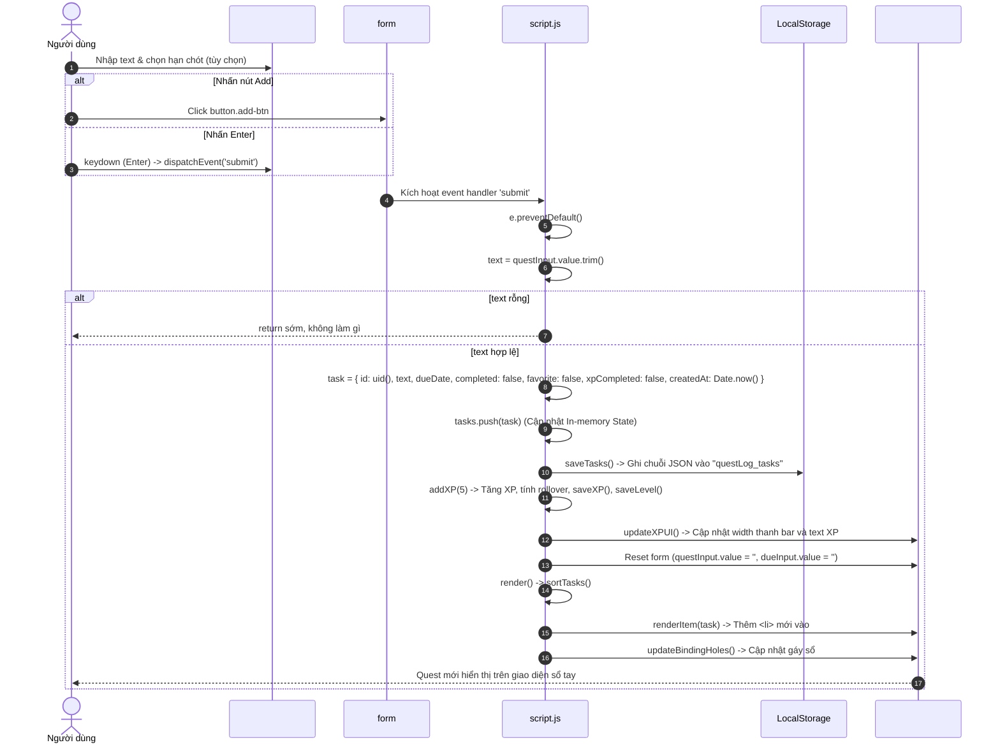
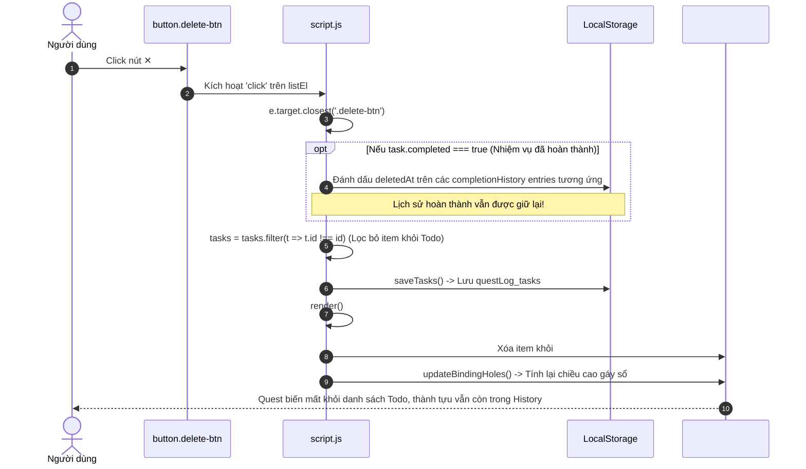
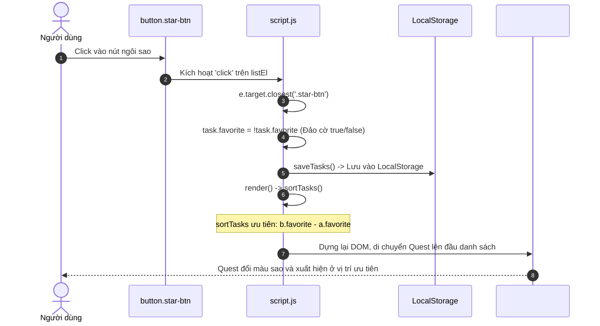

```mermaid
sequenceDiagram
    autonumber
    actor User as Người dùng
    participant Text as p.quest-text
    participant Script as script.js (dblclick listener)
    participant Input as input.edit-input
    participant Storage as LocalStorage
    participant DOM as #questList

    User->>Text: Double click vào dòng chữ nhiệm vụ
    Text->>Script: Kích hoạt 'dblclick' trên listEl (Event Delegation)
    Script->>Script: Tìm closest('.quest-text') & lấy dataset.id
    Script->>Script: Tìm task tương ứng trong mảng tasks
    Script->>DOM: Tạo <input class="edit-input">, gán value = task.text
    Script->>Text: Thêm class 'editing' (CSS ẩn thẻ p)
    Script->>DOM: Chèn input ngay sau thẻ p (p.after(input))
    Script->>Input: input.focus(), input.select()
    
    alt Người dùng nhấn Enter hoặc click ra ngoài (blur)
        User->>Input: Enter / Blur -> finish(true)
        Script->>Script: val = input.value.trim()
        opt val không rỗng
            Script->>Script: task.text = val (Cập nhật In-memory State)
            Script->>Storage: saveTasks() -> Ghi LocalStorage
        end
    else Người dùng nhấn Escape
        User->>Input: Escape -> finish(false)
        note over Script: Bỏ qua không cập nhật task.text
    end
    
    Script->>Input: input.remove()
    Script->>Text: Xóa class 'editing'
    Script->>DOM: render() -> Vẽ lại danh sách đã cập nhật
    DOM-->>User: Nhiệm vụ hiển thị với text mới
```

# [F01–F05] Nhóm Quản Lý Quest (Quest Management Flows)

> **Mã Flow:** F01, F02, F03, F04, F05  
> **Tài liệu cha:** [USER-FLOWS.md](../USER-FLOWS.md)  
> **Mã nguồn liên quan:** [`script.js`](../../script.js) | [`index.html`](../../index.html) | [`style.css`](../../style.css)

Tài liệu này bao quát toàn bộ vòng đời tương tác của một Quest (Nhiệm vụ) trên giao diện ứng dụng **QuestDay Todo List**: từ khi khởi tạo, thiết lập hạn chót, chỉnh sửa nội dung, đánh dấu yêu thích, hoàn thành nhận thưởng cho đến khi xóa bỏ.

---

## 📋 Danh Sách Các Luồng Tương Tác Trong Nhóm

- **[F01: Người dùng tạo Quest mới](#f01-người-dùng-tạo-quest-mới)**
- **[F02: Người dùng sửa Quest (Inline Editing)](#f02-người-dùng-sửa-quest-inline-editing)**
- **[F03: Người dùng hoàn thành / Hủy hoàn thành Quest](#f03-người-dùng-hoàn-thành--hủy-hoàn-thành-quest)**
- **[F04: Người dùng xóa Quest](#f04-người-dùng-xóa-quest)**
- **[F05: Người dùng đánh dấu yêu thích (Star)](#f05-người-dùng-đánh-dấu-yêu-thích-star)**

---

## F01: Người dùng tạo Quest mới

### A. User Scenario
- **Bối cảnh & Vị trí:** Người dùng đang ở màn hình chính, nhìn thấy ô nhập liệu `#questInput` với placeholder *"write a new task..."*.
- **Thao tác:** Người dùng gõ nội dung (ví dụ: *"Ôn tập DSA 45 phút"*), có thể bấm icon lịch (`#dateToggle`) để chọn hạn chót, sau đó bấm nút dấu cộng (`.add-btn`) hoặc nhấn phím `Enter`.
- **Tiền điều kiện:** Ô input có chứa ký tự hợp lệ (không phải chỉ toàn khoảng trắng).
- **Kết quả kỳ vọng:** Nhiệm vụ mới xuất hiện trong danh sách, form nhập liệu được làm sạch, thanh tiến trình XP được cộng thêm 5 điểm, gáy sổ được cập nhật nếu chiều cao thay đổi.

### B. Actual Execution Flow


### C. Source Code Walkthrough
1. **Bắt sự kiện Submit:**
   - Dòng 257–261 trong [`script.js`](../../script.js): Lắng nghe `keydown` trên `#questInput`. Nếu phím gõ là `"Enter"`, kích hoạt `form.dispatchEvent(new Event("submit", { cancelable: true }))`.
   - Dòng 124 trong [`script.js`](../../script.js): `form.addEventListener("submit", (e) => { ... })` tiếp nhận sự kiện.
2. **Ngăn tải lại trang & Xác thực dữ liệu:**
   - Dòng 125–127: Gọi `e.preventDefault()`. Đọc `const text = questInput.value.trim()`. Nếu chuỗi rỗng (`!text`), thoát hàm ngay lập tức (`return`).
3. **Thu thập Deadline:**
   - Dòng 128: `const due = dueInput.value || null` (Lấy giá trị định dạng `YYYY-MM-DD` nếu người dùng đã bật ô lịch qua nút `#dateToggle`).
4. **Khởi tạo đối tượng Task Object:**
   - Dòng 129–137:
     ```javascript
     const task = {
       id: uid(),               // Sinh ID duy nhất dựa trên timestamp base-36 + random
       text,                    // Nội dung công việc
       dueDate: due,            // Hạn chót (null hoặc YYYY-MM-DD)
       completed: false,        // Trạng thái hoàn thành ban đầu
       favorite: false,         // Trạng thái ưu tiên sao vàng
       xpCompleted: false,      // Cờ ghi nhận đã nhận thưởng XP hay chưa
       createdAt: Date.now(),   // Timestamp để sắp xếp theo thời gian tạo
     };
     ```
5. **Cập nhật State & Lưu trữ:**
   - Dòng 138–139: `tasks.push(task)` chèn phần tử mới vào cuối mảng State. Gọi [`saveTasks()`](../../script.js) để ghi xuống khóa `questLog_tasks`.
6. **Thưởng XP khi tạo nhiệm vụ:**
   - Dòng 140: Gọi [`addXP(5)`](../../script.js) (Xem chi tiết tại [02-xp-level.md](02-xp-level.md)).
7. **Dọn dẹp form & Render lại giao diện:**
   - Dòng 141–144: Reset giá trị các ô input, ẩn ô lịch bằng cách xóa class `visible`, và gọi [`render()`](../../script.js) để dựng lại danh sách nhiệm vụ và gáy sổ.

---

## F02: Người dùng sửa Quest (Inline Editing)

### A. User Scenario
- **Bối cảnh:** Nhiệm vụ đã hiển thị trong danh sách nhưng người dùng muốn sửa lại chính tả hoặc thêm ghi chú.
- **Thao tác:** Người dùng nháy đúp chuột (`dblclick`) trực tiếp vào dòng chữ nhiệm vụ (`.quest-text`).
- **Tiền điều kiện:** Nhiệm vụ chưa ở chế độ đang sửa (chưa tồn tại ô `.edit-input`).
- **Kết quả kỳ vọng:** Dòng chữ ẩn đi, xuất hiện một ô `input` chứa sẵn nội dung cũ và được bôi đen (selected). Khi gõ xong nhấn `Enter` hoặc click ra ngoài (`blur`), nội dung mới được lưu; nếu nhấn `Escape`, thao tác sửa bị hủy bỏ và giữ nguyên nội dung cũ.

### B. Actual Execution Flow


### C. Source Code Walkthrough
- **Ủy quyền sự kiện (Event Delegation):** Dòng 183 trong [`script.js`](../../script.js): `listEl.addEventListener("dblclick", (e) => { ... })`.
- **Định vị Task:** Dòng 184–189: Lấy `p = e.target.closest(".quest-text")`, lấy ID qua `li.dataset.id`, và tìm object qua `tasks.find(t => t.id === id)`.
- **Cơ chế chống tạo lặp:** Dòng 190: `if (li.querySelector(".edit-input")) return;` ngăn ngừa việc tạo nhiều ô input nếu người dùng spam click.
- **Tạo phần tử Input động:** Dòng 191–198: Tạo `input`, thêm class `edit-input`, thêm class `editing` vào thẻ `p` (trong [`style.css`](../../style.css), `.quest-text.editing { display: none; }`), chèn vào sau `p` bằng `p.after(input)`, rồi gọi `.focus()` và `.select()`.
- **Closure xử lý kết thúc (`finish`):** Dòng 199–210:
  ```javascript
  const finish = (commit) => {
    if (commit) {
      const val = input.value.trim();
      if (val) {
        task.text = val;
        saveTasks();
      }
    }
    input.remove();
    p.classList.remove("editing");
    render();
  };
  ```
- **Lắng nghe phím & Blur:** Dòng 211–216: Gắn `keydown` bắt `Enter` (`finish(true)`), `Escape` (`finish(false)`), và sự kiện `blur` (`finish(true)`).

---

## F03: Người dùng hoàn thành / Hủy hoàn thành Quest

### A. User Scenario
- **Bối cảnh:** Người dùng đã làm xong công việc và muốn đánh dấu để nhận thưởng, hoặc bấm nhầm muốn hủy hoàn thành.
- **Thao tác:** Người dùng nhấn chuột vào nút checkbox tròn bên trái Quest.
- **Tiền điều kiện:** Quest đang hiển thị trên danh sách.
- **Kết quả kỳ vọng:**
  - **Khi chuyển từ Chưa xong → Đã xong:** Checkbox tích xanh, chữ gạch ngang, hiệu ứng flash sáng lên, ngôi sao bay xuất hiện, cộng +10 XP (nếu hoàn thành lần đầu). Ghi nhận `completedAt`, tạo một bản ghi lịch sử trong `questDay_completionHistory`, và tính toán lại chuỗi Daily Streak.
  - **Khi chuyển từ Đã xong → Chưa xong (Undo):** Checkbox bỏ tích, chữ trở lại bình thường, `completedAt = null`, bản ghi lịch sử tương ứng được chuyển sang trạng thái `undone`. Điểm XP đã nhận **không bị thu hồi**, chuỗi Streak được tính toán lại ngay lập tức.

### B. Actual Execution Flow
```mermaid
sequenceDiagram
    autonumber
    actor User as Người dùng
    participant Box as button.checkbox
    participant Script as script.js (click listener)
    participant Storage as LocalStorage
    participant DOM as #questList, #xpFill & StreakCard

    User->>Box: Click vào checkbox
    Box->>Script: Kích hoạt 'click' trên listEl
    Script->>Script: e.target.closest('.checkbox')
    
    alt Chưa hoàn thành -> Chuyển sang Hoàn thành
        Script->>Script: task.completed = true; task.completedAt = nowIso;
        Script->>Storage: Tạo historyEntry (status: 'completed'), lưu questDay_completionHistory
        opt Hoàn thành lần đầu (!task.xpCompleted)
            Script->>Script: task.xpCompleted = true; addXP(10);
            Script->>DOM: li.classList.add('flash-on'); spawnFloatingStar(li);
        end
    else Đã hoàn thành -> Chuyển sang Hủy hoàn thành (Undo)
        Script->>Script: task.completed = false; task.completedAt = null;
        Script->>Storage: Tìm active entry -> chuyển status: 'undone', lưu questDay_completionHistory
        note over Script: Không trừ XP, không reset task.xpCompleted
    end
    
    Script->>Storage: saveTasks() -> Lưu tasks
    Script->>Script: render() -> updateStreakUI() & sortTasks()
    Script->>DOM: Cập nhật Streak Card, thanh XP và thứ tự danh sách
    DOM-->>User: Giao diện phản hồi trực quan và cập nhật tiến trình
```

### C. Source Code Walkthrough
- **Bắt sự kiện Click:** Dòng 480–542 trong [`script.js`](../../script.js): Lắng nghe `click` trên container `#questList`, tìm thẻ `li` cha và tra cứu `task` theo ID.
- **Xử lý Hoàn thành (Complete):**
  - Gán `task.completed = true` và `task.completedAt = new Date().toISOString()`.
  - Tạo đối tượng `historyEntry` ghi nhận thời điểm hoàn thành và ngày lịch local `completedDate: getTodayString()`. Thêm vào `completionHistory` và gọi `saveCompletionHistory()`.
  - Kiểm tra `if (!task.xpCompleted)`: Thưởng +10 XP, kích hoạt flash và ngôi sao bay. Nếu đây là lần hoàn thành lại sau khi undo, do `task.xpCompleted` đã là `true` nên không cộng XP lần thứ hai.
- **Xử lý Hoàn tác (Uncomplete / Undo):**
  - Gán `task.completed = false` và `task.completedAt = null`.
  - Quét ngược mảng `completionHistory` để tìm bản ghi active (`status === "completed"` và `taskId === task.id`), đổi thành `status = "undone"` và `undoneAt = new Date().toISOString()`.
  - Gọi `saveCompletionHistory()`. Không trừ điểm XP đã thưởng.
- **Đồng bộ & Render:**
  - Gọi `saveTasks()` và `render()`. Trong `render()`, hàm `updateStreakUI()` tự động tính toán lại Streak từ các sự kiện còn hiệu lực.

---

## F04: Người dùng xóa Quest

### A. User Scenario
- **Bối cảnh:** Một nhiệm vụ không còn cần thiết hoặc được tạo nhầm.
- **Thao tác:** Người dùng nhấn vào nút dấu `✕` (`.delete-btn`) ở mép phải của Quest.
- **Tiền điều kiện:** Quest tồn tại trong danh sách.
- **Kết quả kỳ vọng:** Nhiệm vụ biến mất khỏi danh sách quản lý Todo. Nếu nhiệm vụ này đã từng hoàn thành hợp lệ, bản ghi trong `completionHistory` **vẫn được bảo tồn** để không làm mất ngày tính Streak và thành tựu trong tab History.

### B. Actual Execution Flow


### C. Source Code Walkthrough
- **Nhánh xử lý xóa:** Dòng 551–577 trong [`script.js`](../../script.js):
  - Nếu `task.completed === true`: Tìm trong `completionHistory` các mục có `taskId === id` và `status === "completed"`, cập nhật `entry.deletedAt = new Date().toISOString()`, gọi `saveCompletionHistory()`.
  - Lọc mảng `tasks = tasks.filter(t => t.id !== id)`.
  - Gọi `saveTasks()` và `render()`.
- **Bảo toàn dữ liệu lịch sử:** Người dùng có thể dọn dẹp các nhiệm vụ đã hoàn thành cũ mà không sợ mất lịch sử làm việc hay bị tụt chuỗi Streak.

---

## F05: Người dùng đánh dấu yêu thích (Star)

### A. User Scenario
- **Bối cảnh:** Người dùng có một nhiệm vụ quan trọng cần làm ngay trong ngày.
- **Thao tác:** Người dùng nhấn vào biểu tượng ngôi sao (`.star-btn`) bên cạnh nhiệm vụ.
- **Tiền điều kiện:** Quest đang hiển thị.
- **Kết quả kỳ vọng:** Ngôi sao chuyển sang màu vàng đậm, nhiệm vụ được gắn viền/nền nổi bật và tự động bay lên vị trí trên cùng của danh sách.

### B. Actual Execution Flow


### C. Source Code Walkthrough
- **Nhánh xử lý sao:** Dòng 171–174 trong [`script.js`](../../script.js):
  ```javascript
  else if (e.target.closest(".star-btn")) {
    task.favorite = !task.favorite;
    saveTasks();
    render();
  }
  ```
- **Logic sắp xếp trong [`sortTasks()`](../../script.js) (Dòng 67–75):**
  - Tiêu chí 1: `if (a.favorite !== b.favorite) return b.favorite - a.favorite;`
  - Do `true` ép kiểu số thành `1` và `false` thành `0`, phép tính `b.favorite - a.favorite` sẽ luôn đưa phần tử có `favorite: true` lên trước.
- **Áp dụng class CSS trong [`renderItem()`](../../script.js) (Dòng 110, 118–119):**
  - Gắn class `important` vào thẻ `li` (đổi viền và màu giấy nổi bật).
  - Gắn class `active` vào nút `starBtn` và gán thuộc tính `starBtn.dataset.favorite = task.favorite`.

---

## D. State and LocalStorage

### 1. In-Memory State
- Biến trạng thái trung tâm: `let tasks = [...]`.
- Cấu trúc đối tượng phần tử (`task` object):
  ```typescript
  interface Task {
    id: string;          // Chuỗi ID duy nhất (VD: "m4k2a9x3z1")
    text: string;        // Nội dung công việc (chuỗi đã trim)
    dueDate: string|null;// "YYYY-MM-DD" hoặc null
    completed: boolean;  // true nếu đã xong, false nếu chưa
    favorite: boolean;   // true nếu được gắn sao, false nếu không
    xpCompleted: boolean;// true nếu đã từng nhận 10 XP thưởng
    createdAt: number;   // Timestamp (Date.now())
  }
  ```

### 2. LocalStorage Persistence
- **Khóa tác động:** Duy nhất khóa `"questLog_tasks"` (và các khóa XP nếu hoàn thành/thêm task).
- **Thời điểm tuần tự hóa (Serialization):** Mỗi khi mảng `tasks` thay đổi (thêm, sửa, xóa, check, star), hàm [`saveTasks()`](../../script.js) được gọi ngay lập tức:
  `localStorage.setItem("questLog_tasks", JSON.stringify(tasks));`
- **Độ bền vững:** Khi F5 hoặc mở lại trình duyệt, toàn bộ các thuộc tính (`text`, `dueDate`, `completed`, `favorite`, `xpCompleted`) được bảo toàn tuyệt đối.

---

## E. UI Update / Visual Feedback

| Tương tác | Thao tác DOM | Phản hồi trực quan người dùng nhìn thấy |
| :--- | :--- | :--- |
| **F01 (Add)** | Append thẻ `<li>` mới vào `#questList`. | Task mới xuất hiện trên dòng kẻ vở; form trở về rỗng; thanh XP dài ra một chút. |
| **F02 (Edit)** | Thêm thẻ `<input class="edit-input">`, ẩn `<p>`. Khi xong, xóa `input` và hiện lại `<p>`. | Chữ chuyển thành ô nhập có viền nét đứt màu nâu; khi lưu chữ đổi thành text mới. |
| **F03 (Complete)**| Toggle class `checked` trên checkbox, `completed` trên `li`. Thêm tạm thời `.flash-on` và `.floating-star`. | Vệt sáng flash quét qua task; ngôi sao `★` vàng bay bổng lên trên; task trôi xuống dưới. |
| **F04 (Delete)** | Xóa bỏ node `<li>` khỏi `#questList`. | Task biến mất lập tức; các task bên dưới dồn lên; gáy sổ co lại nếu giảm dòng. |
| **F05 (Star)** | Toggle class `active` trên `.star-btn` và `important` trên `li`. | Biểu tượng ngôi sao chuyển sang màu vàng đậm; task nhảy vọt lên đầu danh sách. |

---

## F. Edge Cases & Known Behaviors

1. **Người dùng nhập text toàn dấu cách khi tạo hoặc sửa Quest:**
   - *Thực tế code:* Cả `submit` và `finish()` đều gọi `.trim()`. Nếu kết quả là chuỗi rỗng `""`, `submit` sẽ `return` không tạo task; `finish()` sẽ bỏ qua và giữ nguyên nội dung cũ của task.
2. **Người dùng sửa task thành chuỗi rỗng:**
   - *Thực tế code:* Không xóa task mà giữ nguyên text ban đầu của task trước khi sửa.
3. **Spam click liên tục vào Checkbox:**
   - *Thực tế code:* Cờ `xpCompleted` chỉ gán `true` ở lần đầu tiên. Những lần click sau chỉ toggle cờ `completed` và đổi vị trí mà không phát sinh thêm XP.
4. **Xóa Quest chưa có dialog xác nhận:**
   - *Thực tế code:* Hiện tại khi bấm `✕`, task bị xóa ngay lập tức không hỏi lại. Đây là hành vi hiện tại của code gốc.
5. **Định dạng ngày (Due Date) không hợp lệ:**
   - *Thực tế code:* Ô nhập sử dụng `<input type="date">` chuẩn của trình duyệt nên dữ liệu luôn tuân thủ chuẩn `YYYY-MM-DD` hoặc rỗng (`null`).

---

## G. Debug Guide

1. **Vị trí đặt Breakpoints trong [`script.js`](../../script.js):**
   - Dòng 124: `form.addEventListener("submit", ...)` để kiểm tra dữ liệu lấy từ ô input.
   - Dòng 154: `listEl.addEventListener("click", ...)` để kiểm tra click delegation vào checkbox, star hay delete.
   - Dòng 183: `listEl.addEventListener("dblclick", ...)` để quan sát cơ chế tạo thẻ input sửa tại chỗ.
   - Dòng 199: Hàm `finish(commit)` để kiểm tra giá trị sau khi sửa inline.
2. **Biến cần đưa vào Watch Expressions:**
   - `tasks`
   - `task`
   - `e.target`
   - `input.value`
3. **Cách tự khắc phục lỗi giao diện không cập nhật:**
   - Kiểm tra xem sau khi sửa `task` có gọi lệnh `saveTasks()` và `render()` hay không. Nếu thiếu `render()`, DOM sẽ không được vẽ lại dù State trong RAM đã đổi.

---

## H. Manual Test Steps

| Test Case | Các bước thực hiện | Kết quả mong đợi |
| :---: | :--- | :--- |
| **TC-01** | Nhập `   ` (toàn khoảng trắng) vào form và nhấn Enter. | Không có task nào được tạo; form giữ nguyên hoặc không thêm item rỗng. |
| **TC-02** | Nhập `"Task A"`, bấm Add. Bấm checkbox của Task A. | Checkbox tích xanh, text gạch ngang, có hiệu ứng ngôi sao bay và thanh XP tăng 10 điểm. |
| **TC-03** | Bỏ tích Task A rồi tích lại lần 2. | Checkbox đảo trạng thái nhưng thanh XP **không tăng thêm điểm**. |
| **TC-04** | Nháy đúp vào chữ `"Task A"`, sửa thành `"Task A Plus"`, nhấn `Enter`. | Tên đổi thành `"Task A Plus"`. Nhấn F5 thấy tên mới vẫn được lưu. |
| **TC-05** | Nháy đúp vào chữ, sửa thành gì đó rồi nhấn phím `Escape`. | Thao tác sửa bị hủy, tên task quay lại nguyên trạng cũ. |
| **TC-06** | Tạo thêm `"Task B"`, sau đó bấm nút ngôi sao của Task B. | Task B nhảy lên xếp phía trên Task A dù được tạo sau. |
| **TC-07** | Nhấn nút `✕` trên Task B. | Task B biến mất hoàn toàn. Nhấn F5 xác nhận Task B không còn. |

---

## I. Learning Check

1. **Tại sao việc lắng nghe sự kiện click trên từng item lại dùng kỹ thuật Event Delegation (`listEl.addEventListener("click", ...)`) thay vì gắn listener vào từng nút bấm khi tạo?**  
   *Trả lời:* Vì danh sách nhiệm vụ liên tục được xóa và vẽ lại toàn bộ qua hàm `render()`. Nếu gắn listener trực tiếp vào từng button, mỗi lần re-render sẽ phải đăng ký lại các listener gây tốn bộ nhớ và dễ rò rỉ bộ nhớ (memory leaks). Event Delegation tận dụng cơ chế Event Bubbling của DOM, chỉ cần 1 listener duy nhất trên thẻ cha `#questList`.
2. **Tại sao hàm `sortTasks()` lại xếp các task theo thứ tự: Favorite → Incomplete → CreatedAt?**  
   *Trả lời:* Đây là nguyên lý UX ưu tiên công việc: Những việc quan trọng (Favorite) cần người dùng thấy đầu tiên; những việc chưa làm (Incomplete) quan trọng hơn việc đã làm rồi (Complete); và trong cùng nhóm thì việc vừa tạo mới nhất (CreatedAt) được đặt lên đầu để dễ theo dõi.
3. **Nếu người dùng xóa một task đã nhận thưởng 10 XP, biến `xp` và `level` có bị giảm đi không? Tại sao?**  
   *Trả lời:* Không bị giảm. Trong hàm xử lý xóa (`delete-btn`), code chỉ lọc mảng `tasks` và gọi `saveTasks()`, hoàn toàn không có lời gọi trừ XP hay tính toán lại cấp độ. XP trong cơ chế game này là tích lũy vĩnh viễn.

