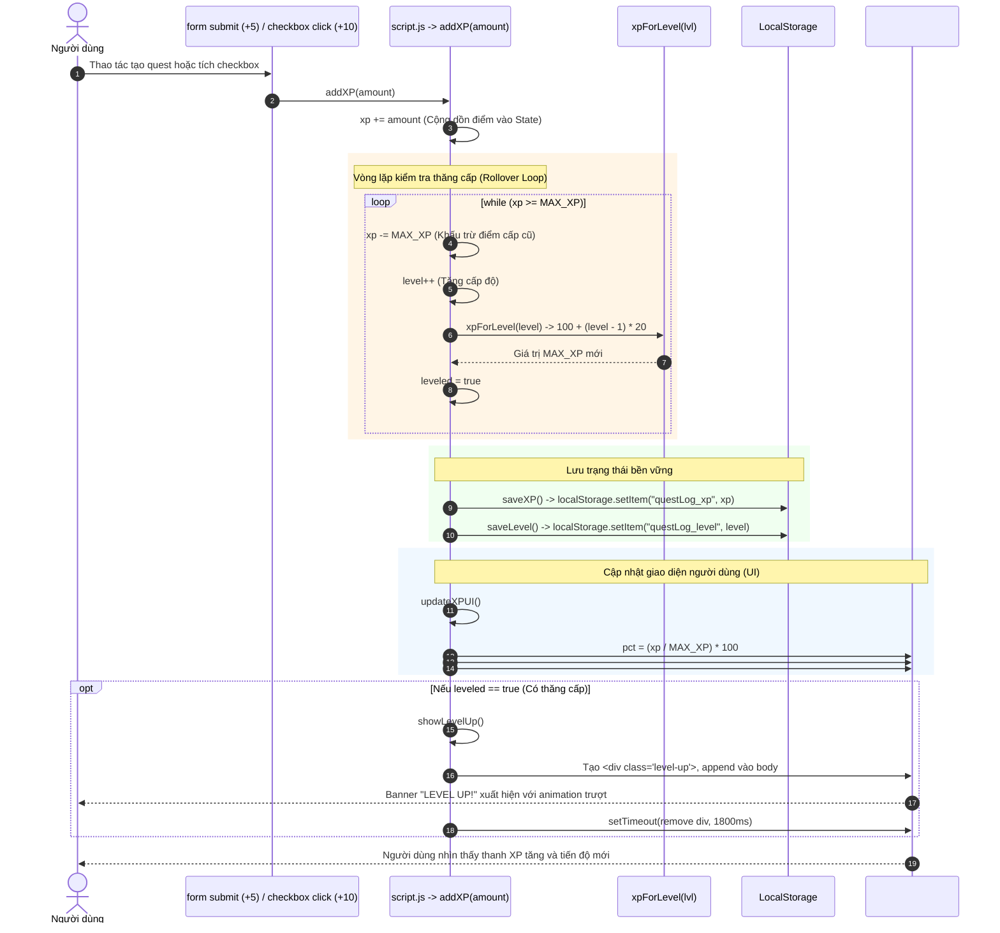

# [F06] Cơ Chế XP, Thăng Cấp & Tiến Trình (XP System & Level Up)

> **Mã Flow:** F06  
> **Tài liệu cha:** [USER-FLOWS.md](../USER-FLOWS.md)  
> **Mã nguồn liên quan:** [`script.js`](../../script.js) | [`index.html`](../../index.html) | [`style.css`](../../style.css)

---

## A. User Scenario

- **Bối cảnh & Vị trí:** Người dùng đang thao tác trên giao diện chính của ứng dụng và thực hiện các hành động có thưởng điểm:
  1. Thêm một Quest mới (+5 XP).
  2. Đánh dấu hoàn thành một Quest chưa từng hoàn thành trước đó (+10 XP).
- **Thao tác:** Người dùng bấm Submit tạo Quest hoặc bấm vào nút Checkbox của một nhiệm vụ.
- **Tiền điều kiện:** Điểm XP hiện tại của người dùng cộng thêm điểm thưởng có thể chưa đủ hoặc vượt quá ngưỡng `MAX_XP` của cấp độ hiện tại.
- **Kết quả kỳ vọng:**
  - Thanh tiến trình XP màu xanh dài ra tương ứng với tỷ lệ phần trăm điểm kiếm được.
  - Số điểm hiển thị trên nhãn text thay đổi theo định dạng `Lv [level] • [xp]/[MAX_XP] XP`.
  - **Nếu đủ điểm lên cấp (Level Up):**
    - Cấp độ `level` tăng thêm 1 (hoặc nhiều hơn nếu điểm dư lớn).
    - Ngưỡng điểm cần cho cấp mới tự động tăng thêm 20 điểm.
    - Điểm XP dư thừa được giữ lại (rollover) cho cấp tiếp theo thay vì bị mất.
    - Banner chúc mừng màu vàng `"LEVEL UP!"` trượt xuống từ góc trên bên phải màn hình và tự mờ dần sau 1.8 giây.

---

## B. Actual Execution Flow

Chuỗi thực thi hàm xử lý logic điểm kinh nghiệm và thăng cấp diễn ra tuần tự như sau:



---

## C. Source Code Walkthrough

Mã nguồn cơ chế RPG nằm tại các dòng trọng yếu sau trong [`script.js`](../../script.js):

### 1. Công thức tính ngưỡng thăng cấp (`xpForLevel`)
- **Dòng 7–9 trong [`script.js`](../../script.js):**
  ```javascript
  function xpForLevel(lvl) {
    return 100 + (lvl - 1) * 20;
  }
  ```
  - **Bản chất toán học:** Cấp 1 cần 100 XP; Cấp 2 cần 120 XP; Cấp 3 cần 140 XP; Cấp $n$ cần $100 + (n - 1) \times 20$ XP.
  - Mục đích: Tạo độ khó lũy tiến (progression curve) nhẹ nhàng, mang lại cảm giác thỏa mãn vừa phải cho ứng dụng Todo List cá nhân.

### 2. Hàm trung tâm cộng điểm & Xử lý tràn cấp (`addXP`)
- **Dòng 78–92 trong [`script.js`](../../script.js):**
  ```javascript
  function addXP(amount) {
    xp += amount;
    // level ups if overflow
    let leveled = false;
    while (xp >= MAX_XP) {
      xp -= MAX_XP;
      level++;
      MAX_XP = xpForLevel(level);
      leveled = true;
    }
    saveXP();
    saveLevel();
    updateXPUI();
    if (leveled) showLevelUp();
  }
  ```
  - **Caller:** Được gọi từ 2 nơi:
    1. Form submit khi tạo task mới: dòng 140 gọi `addXP(5)`.
    2. Checkbox click khi hoàn thành task lần đầu: dòng 164 gọi `addXP(10)`.
  - **Thuật toán vòng lặp `while (xp >= MAX_XP)`:**
    - Khác với câu lệnh `if` thông thường, vòng lặp `while` xử lý được trường hợp lượng điểm thưởng cực lớn vượt qua nhiều cấp độ cùng lúc.
    - Điểm thừa không bị cắt bỏ mà được dồn tự nhiên vào thanh tiến trình của cấp tiếp theo (`xp -= MAX_XP`).
  - **Callee:** Gọi liên tiếp `saveXP()`, `saveLevel()`, `updateXPUI()`, và gọi `showLevelUp()` nếu biến cờ `leveled` là `true`.

### 3. Cập nhật giao diện thanh tiến trình (`updateXPUI`)
- **Dòng 204–213 trong [`script.js`](../../script.js):**
  ```javascript
  function updateXPUI() {
    const pct = Math.min(100, (xp / MAX_XP) * 100);
    xpFill.style.width = pct + "%";
    xpValue.textContent = `Lv ${level} • ${xp}/${MAX_XP} XP`;
    if (xpRemaining) {
      const needed = Math.max(0, MAX_XP - xp);
      xpRemaining.textContent = `${needed} XP to Level ${level + 1}`;
    }
  }
  ```
  - `Math.min(100, ...)` đảm bảo chiều rộng thanh không bao giờ tràn quá 100% gây vỡ layout.
  - Hiển thị nhãn phụ `#xpRemaining` cho người chơi biết chính xác còn cần bao nhiêu điểm để thăng cấp tiếp theo.
  - Trong [`style.css`](../../style.css), thuộc tính `transition: width 0.6s ease;` giúp thanh bar tăng trưởng mượt mà, không bị giật cục.

### 4. Hiển thị thông báo thăng cấp (`showLevelUp`)
- **Dòng 227–233 trong [`script.js`](../../script.js):**
  ```javascript
  function showLevelUp() {
    const div = document.createElement("div");
    div.className = "level-up";
    div.textContent = "LEVEL UP!";
    document.body.appendChild(div);
    setTimeout(() => div.remove(), 1800);
  }
  ```
  - Phần tử được tạo và chèn động vào cuối thẻ `<body>`.
  - Animation `@keyframes fadeSlide` trong [`style.css`](../../style.css) điều khiển banner trượt xuống và biến mất.
  - Timer `setTimeout(..., 1800)` tự động dọn dẹp DOM node sau khi animation kết thúc để tránh rác bộ nhớ.

---

## D. State and LocalStorage

### 1. In-Memory State
- `xp`: Số nguyên (`number`), biểu diễn lượng XP hiện tại của người chơi trong cấp độ hiện hành ($0 \le xp < MAX\_XP$).
- `level`: Số nguyên dương (`number`), biểu thị cấp bậc hiện tại ($level \ge 1$).
- `MAX_XP`: Số nguyên (`number`), ngưỡng điểm tối đa của cấp hiện hành.

### 2. LocalStorage Persistence
- **Khóa liên quan:**
  - `STORAGE_KEY_XP = "questLog_xp"`
  - `STORAGE_KEY_LEVEL = "questLog_level"`
- **Thời điểm ghi:** Được ghi đồng bộ ngay trong hàm `addXP()` thông qua [`saveXP()`](../../script.js) và [`saveLevel()`](../../script.js).
- **Hành vi sau khi Reload:**
  - `level = loadLevel()` đọc giá trị đã lưu, tính lại `MAX_XP = xpForLevel(level)`.
  - `xp = loadXP()` nạp lại số điểm hiện tại.
  - Toàn bộ thanh tiến trình và cấp độ được phục hồi chính xác 100%.

---

## E. UI Update / Visual Feedback

Khi luồng F06 kích hoạt, người dùng sẽ quan sát thấy:
1. **Thanh kinh nghiệm (`#xpFill`):** Dải màu xanh chuyển động êm ái sang phải (hiệu ứng 0.6s).
2. **Nhãn thông tin (`#xpValue`):** Cập nhật số điểm mới tức thì (ví dụ: từ `Lv 1 • 5/100 XP` lên `Lv 1 • 15/100 XP`).
3. **Khi đạt mốc Level Up:**
   - Thanh kinh nghiệm co về mức điểm dư (ví dụ: `Lv 2 • 5/120 XP`).
   - Một huy hiệu màu vàng kim dạng ribbon mang chữ **LEVEL UP!** trượt nhẹ từ đỉnh màn hình xuống góc trên bên phải, tỏa bóng mờ retro và biến mất sau gần 2 giây.

---

## F. Edge Cases & Known Behaviors

1. **Người dùng nhận lượng XP cực lớn (vượt ngưỡng nhiều cấp):**
   - *Thực tế code:* Nhờ vòng lặp `while (xp >= MAX_XP)`, hệ thống có thể tăng liên tiếp 2 hoặc nhiều cấp độ trong một lần gọi mà không bị treo hay tính sai điểm dư.
2. **Giá trị XP trong LocalStorage bị sửa đổi thành số âm hoặc chuỗi:**
   - *Thực tế code:* `loadXP()` dùng `parseInt(..., 10)`. Nếu là chuỗi lạ, trả về `NaN` và được fallback về `0`. Nếu người dùng cố tình nhập số âm, `xp` sẽ âm và thanh hiển thị sẽ có `width: 0%` cho đến khi kiếm đủ điểm bù lại.
3. **Spam checkbox để farm điểm (Complete -> Uncomplete -> Complete):**
   - *Thực tế code:* Đã được chặn bằng cờ `task.xpCompleted = true`. Khi một Quest đã từng hoàn thành và nhận +10 XP, dù sau đó người dùng có bỏ tích rồi tích lại bao nhiêu lần, `task.xpCompleted` vẫn giữ nguyên giá trị `true` và câu lệnh `addXP(10)` tuyệt đối không bao giờ được gọi lại.
4. **Xóa Quest có bị trừ điểm không:**
   - *Thực tế code:* Hiện tại **không trừ điểm**. Điểm XP đã nhận là vĩnh viễn, người dùng có thể xóa quest sau khi làm xong mà không sợ mất cấp độ.
5. **Tại sao không dùng Completion History để tính toán lại toàn bộ XP lúc khởi động?**
   - *Thực tế code:* Điểm XP trong hệ thống đến từ hai nguồn khác nhau: (1) Tạo quest mới (+5 XP) và (2) Hoàn thành quest lần đầu (+10 XP). `completionHistory` chỉ ghi lại các sự kiện hoàn thành, không ghi lại lịch sử tạo quest. Nếu tính lại XP từ history, toàn bộ XP từ các thao tác tạo quest trước đó sẽ bị mất. Vì vậy, `questLog_xp` và `questLog_level` được lưu trữ bền vững độc lập.

---

## G. Debug Guide

1. **Vị trí đặt Breakpoint trong [`script.js`](../../script.js):**
   - Dòng 78: Bắt đầu hàm `addXP(amount)` để theo dõi giá trị tham số `amount` truyền vào.
   - Dòng 82: Bắt đầu vòng lặp `while (xp >= MAX_XP)` để quan sát cơ chế rollover điểm kinh nghiệm.
   - Dòng 94: Trong `updateXPUI()` để kiểm tra công thức tính tỷ lệ `%`.
   - Dòng 227: Trong `showLevelUp()` để kiểm tra banner thông báo.
2. **Biến cần đưa vào Watch Expressions:**
   - `xp`
   - `level`
   - `MAX_XP`
   - `amount`
   - `leveled`
   - `pct`
3. **Lệnh Console thử nghiệm nhanh cơ chế Level Up:**
   - Mở Console DevTools (`F12`), gõ: `addXP(95);` và nhấn Enter để xem thanh tiến trình nhảy vọt và kích hoạt thăng cấp.

---

## H. Manual Test Steps

| Test Case | Các bước thực hiện | Kết quả mong đợi |
| :---: | :--- | :--- |
| **TC-XP-01** | Tạo mới 1 Quest bất kỳ. | Điểm XP tăng thêm 5. Nhãn hiển thị `Lv 1 • 5/100 XP`. |
| **TC-XP-02** | Bấm checkbox hoàn thành Quest vừa tạo. | Điểm XP tăng thêm 10. Nhãn hiển thị `Lv 1 • 15/100 XP`. Có hiệu ứng ngôi sao bay. |
| **TC-XP-03** | Mở Console, gõ: `addXP(85);` (đạt đúng 100/100 XP). | Xuất hiện banner `LEVEL UP!`. Level tăng lên 2. Nhãn hiển thị `Lv 2 • 0/120 XP`. |
| **TC-XP-04** | Nhấn `F5` tải lại trang. | Cấp độ và điểm số vẫn giữ nguyên `Lv 2 • 0/120 XP`. |
| **TC-XP-05** | Mở Console, gõ: `addXP(250);` (vượt ngưỡng nhiều cấp). | Level tăng vọt lên 3 rồi 4, điểm dư được tính đúng theo công thức lũy tiến. |

---

## I. Learning Check

1. **Tại sao công thức tính điểm yêu cầu là `100 + (lvl - 1) * 20` mà không phải là một con số cố định như 100 cho mọi cấp?**  
   *Trả lời:* Trong tâm lý học hành vi và thiết kế trò chơi (Gamification), việc tăng dần độ khó tạo ra cảm giác thử thách và ngăn chặn người chơi đạt cấp tối đa quá dễ dàng, đồng thời giữ cho trải nghiệm hoàn thành công việc luôn mới mẻ.
2. **Nếu thay vòng lặp `while (xp >= MAX_XP)` bằng câu lệnh điều kiện `if (xp >= MAX_XP)`, lỗi logic gì sẽ xảy ra khi nhận được lượng XP lớn hơn gấp đôi `MAX_XP`?**  
   *Trả lời:* Nếu dùng `if`, người chơi chỉ được tăng tối đa 1 level, và lượng điểm dư còn lại sau khi trừ cấp đó có thể vẫn lớn hơn `MAX_XP` của cấp mới, dẫn đến tình trạng điểm hiện tại vượt quá điểm tối đa hiển thị trên thanh bar (ví dụ: `150/120 XP`). Vòng lặp `while` đảm bảo trừ điểm và tăng cấp liên tục cho đến khi điểm dư thực sự nhỏ hơn ngưỡng của cấp độ mới.
3. **Tại sao thẻ `<div class="level-up">` lại cần được xóa bằng `setTimeout` sau 1.8 giây thay vì để nguyên trên trang?**  
   *Trả lời:* Để giải phóng bộ nhớ DOM (tránh DOM bloat). Nếu không xóa, mỗi lần lên cấp một thẻ `div` mới lại được nhét vào thẻ `<body>`, tích tụ hàng chục thẻ rác vô hình trong tài liệu HTML.

