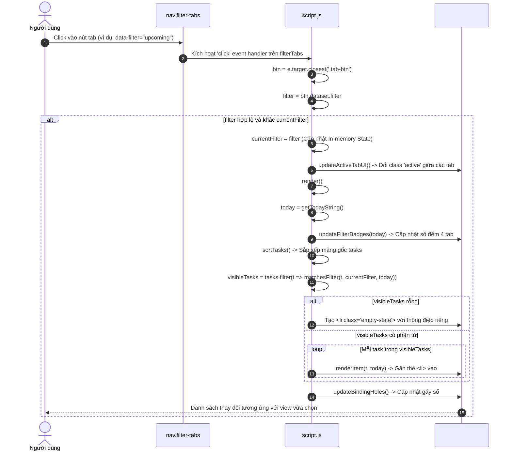
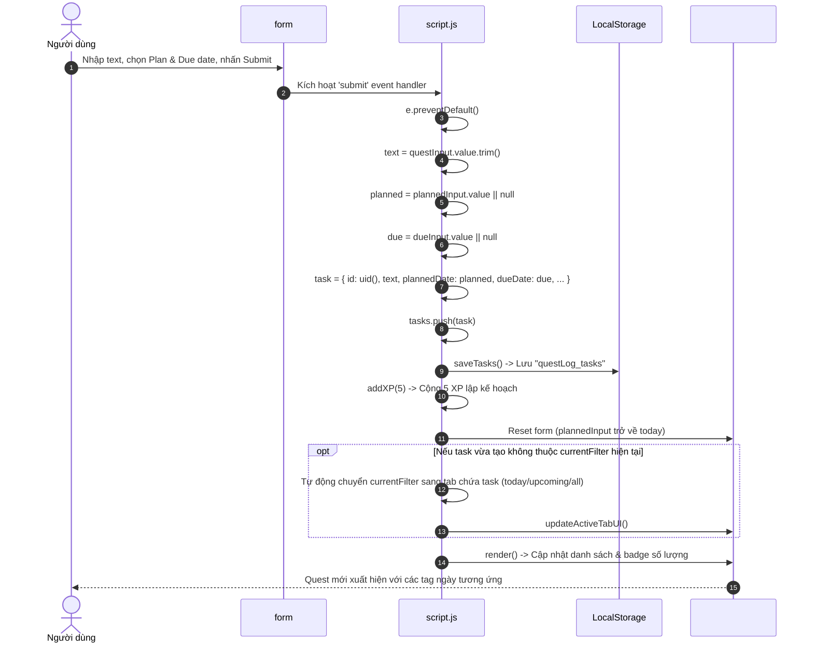
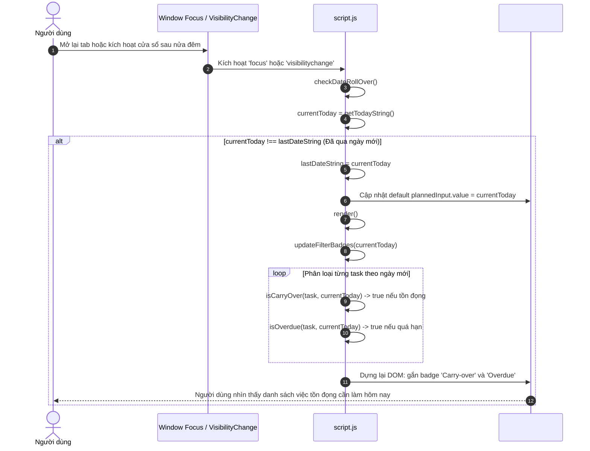

# [F07–F10] Nhóm Quản Lý Kế Hoạch Hằng Ngày (Daily Task Management Flows)

> **Mã Flow:** F07, F08, F09, F10  
> **Tài liệu cha:** [USER-FLOWS.md](../USER-FLOWS.md)  
> **Mã nguồn liên quan:** [`script.js`](../../script.js) | [`index.html`](../../index.html) | [`style.css`](../../style.css)

Tài liệu này phân tích chi tiết nhóm tương tác cốt lõi thuộc **Milestone M01 — Daily Task Management** trong ứng dụng **QuestDay Todo List**, cho phép người dùng lập kế hoạch làm việc theo ngày (`plannedDate`), đặt hạn chót độc lập (`dueDate`), chuyển đổi giữa 4 chế độ xem (`Today`, `Upcoming`, `Overdue`, `All`), dời lịch (`Reschedule`), và cơ chế gối đầu tự động sang ngày hôm sau (`Carry-over`).

---

## 📋 Danh Sách Các Luồng Tương Tác Trong Nhóm

- **[F07: Người dùng chuyển đổi chế độ xem (Switch Daily View)](#f07-người-dùng-chuyển-đổi-chế-độ-xem-switch-daily-view)**
- **[F08: Người dùng tạo Quest có kế hoạch (Create Scheduled Quest)](#f08-người-dùng-tạo-quest-có-kế-hoạch-create-scheduled-quest)**
- **[F09: Người dùng thay đổi ngày / dời lịch (Reschedule Quest)](#f09-người-dùng-thay-đổi-ngày--dời-lịch-reschedule-quest)**
- **[F10: Người dùng quay lại vào ngày mới (New Day & Rollover)](#f10-người-dùng-quay-lại-vào-ngày-mới-new-day--rollover)**

---

## F07: Người dùng chuyển đổi chế độ xem (Switch Daily View)

### A. User Scenario
- **Bối cảnh & Vị trí:** Người dùng đang ở màn hình chính, nhìn thấy thanh tab điều hướng gồm 4 nhãn: `Today`, `Upcoming`, `Overdue`, `All` cùng các badge số lượng nhiệm vụ tương ứng.
- **Thao tác:** Người dùng click chuột vào một trong các tab (ví dụ: click vào tab `Upcoming` hoặc `Overdue`).
- **Tiền điều kiện:** Ứng dụng đã nạp xong danh sách `tasks` vào bộ nhớ RAM. Tab được click khác với tab đang kích hoạt (`currentFilter`).
- **Kết quả kỳ vọng:**
  - Tab vừa click chuyển sang trạng thái Active (nổi bật viền và màu nền sổ tay).
  - Danh sách `#questList` ngay lập tức lọc và hiển thị đúng các Quest thỏa mãn tiêu chí của chế độ xem đó.
  - Nếu danh sách lọc rỗng, hiển thị thông điệp Empty State thân thiện phù hợp với từng tab.
  - Số lượng gáy xoắn ốc được tính toán lại theo chiều cao mới của danh sách.

### B. Preconditions
- Mảng `tasks` trong RAM chứa các đối tượng nhiệm vụ có hoặc không có `plannedDate` / `dueDate`.
- Khóa `currentFilter` lưu trữ trạng thái view hiện thời (mặc định là `"today"`).

### C. Actual Execution Flow


### D. Step-by-Step Source Walkthrough
1. **Lắng nghe sự kiện:**
   - Dòng 361–373 trong [`script.js`](../../script.js): Lắng nghe `click` trên container `filterTabs`.
   - Tìm kiếm phần tử nút: `const btn = e.target.closest(".tab-btn");`.
2. **Kiểm tra trạng thái & Đổi View:**
   - Lấy thuộc tính `const filter = btn.dataset.filter;`.
   - Kiểm tra điều kiện `if (filter && filter !== currentFilter)`.
   - Gán `currentFilter = filter`.
   - Gọi [`updateActiveTabUI()`](../../script.js): Xóa class `active` trên tab cũ và thêm class `active` vào tab mới.
3. **Lọc dữ liệu chiếu theo View:**
   - Trong [`render()`](../../script.js):
     - Lấy ngày địa phương hiện tại: `const today = getTodayString()`.
     - Cập nhật số đếm badge: [`updateFilterBadges(today)`](../../script.js).
     - Lọc mảng `tasks` thông qua hàm [`matchesFilter(t, currentFilter, today)`](../../script.js):
       - `today`: Gọi `matchesToday(t, today)`.
       - `upcoming`: Gọi `matchesUpcoming(t, today)`.
       - `overdue`: Gọi `matchesOverdue(t, today)`.
       - `all`: Trả về `true` cho toàn bộ nhiệm vụ.
4. **Hiển thị Empty State:**
   - Nếu `visibleTasks.length === 0`, tạo phần tử `li.empty-state` hiển thị câu chào từ từ điển `EMPTY_MESSAGES[currentFilter]`.
5. **Dựng lại DOM & Gáy sổ:**
   - Thêm các thẻ nhiệm vụ vào `#questList` và gọi `updateBindingHoles()`.

### E. State & LocalStorage Changes
- **In-Memory State:** Biến toàn cục `currentFilter` đổi giá trị sang `"today" | "upcoming" | "overdue" | "all"`. Mảng `tasks` không bị biến đổi cấu trúc hay mất mát dữ liệu.
- **LocalStorage:** **Không có bất kỳ thao tác ghi nào** vào LocalStorage. Chuyển tab chỉ là thay đổi góc nhìn (view projection) trên cùng một nguồn dữ liệu duy nhất.

### F. Visible UI Result
- Nút tab được chọn chuyển nền màu giấy sáng, chữ đậm và viền dưới liền mạch với khối danh sách.
- Danh sách nhiệm vụ co giãn tương ứng:
  - Tab `Today`: Chỉ thấy việc cần làm hôm nay hoặc việc tồn đọng (Carry-over).
  - Tab `Upcoming`: Chỉ thấy việc có kế hoạch trong tương lai.
  - Tab `Overdue`: Chỉ thấy việc chưa hoàn thành đã quá hạn chót.
  - Tab `All`: Thấy toàn bộ công việc (kể cả việc chưa lên lịch).

### G. Edge Cases
- Người dùng click vào chính tab đang active: Khối lệnh bỏ qua không re-render không cần thiết.
- Badge Overdue hiển thị màu đỏ cảnh báo (`.has-overdue`) khi số lượng `overdue > 0`, và trở về màu trung tính khi bằng 0.

### H. Debug Guide
- Đặt breakpoint tại dòng 362 [`script.js`](../../script.js) trong listener của `filterTabs`.
- Thêm Watch Expression: `currentFilter`, `visibleTasks.length`, `counts`.

---

## F08: Người dùng tạo Quest có kế hoạch (Create Scheduled Quest)

### A. User Scenario
- **Bối cảnh & Vị trí:** Người dùng đang ở form tạo Quest `#questForm`.
- **Thao tác:** Người dùng nhập nội dung công việc (ví dụ: *"Báo cáo đồ án tốt nghiệp"*), chọn ngày thực hiện tại ô `📅 Plan:`, chọn hạn chót tại ô `⏰ Due:`, sau đó nhấn nút Add hoặc phím Enter.
- **Tiền điều kiện:** Ô input mô tả có chữ. `plannedInput` mặc định điền ngày hôm nay (người dùng có thể sửa hoặc xóa).
- **Kết quả kỳ vọng:** Nhiệm vụ được tạo với đầy đủ `plannedDate` và `dueDate`, lưu trữ bền vững vào LocalStorage, thưởng +5 XP, form làm mới trở về mặc định hôm nay.

### B. Preconditions
- Người dùng nhập chuỗi văn bản hợp lệ sau khi `.trim()`.

### C. Actual Execution Flow


### D. Step-by-Step Source Walkthrough
1. **Thu thập dữ liệu form:**
   - Dòng 301–308 trong [`script.js`](../../script.js): Lấy `text`, `plannedInput.value || null`, `dueInput.value || null`.
2. **Khởi tạo đối tượng Task đầy đủ Schema M01:**
   - Dòng 310–319:
     ```javascript
     const task = {
       id: uid(),
       text,
       plannedDate: planned,   // "YYYY-MM-DD" hoặc null
       dueDate: due,           // "YYYY-MM-DD" hoặc null
       completed: false,
       favorite: false,
       xpCompleted: false,
       createdAt: Date.now(),
     };
     ```
3. **Lưu trữ & Thưởng kinh nghiệm:**
   - Dòng 321–323: `tasks.push(task)`, `saveTasks()`, `addXP(5)`.
4. **Tự động chuyển View thông minh (Smart View Switch):**
   - Dòng 331–340: Nếu người dùng đang đứng ở tab `Overdue` mà tạo một task mới có kế hoạch `Today`, nếu giữ nguyên view thì task sẽ không xuất hiện gây hiểu lầm là lưu thất bại. Hệ thống tự động chuyển `currentFilter` sang `"today"` (hoặc `"upcoming"` nếu tạo ngày mai) để người dùng lập tức nhìn thấy nhiệm vụ vừa tạo.
5. **Render & Badges:**
   - Gọi `render()`, tạo thẻ `li` với các nhãn tag `📅 Plan: ...` và `⏰ Due: ...`.

### E. State & LocalStorage Changes
- **In-Memory State:** Thêm 1 phần tử vào mảng `tasks` có trường `plannedDate` và `dueDate`.
- **LocalStorage:** Ghi chuỗi JSON chứa task mới vào khóa `questLog_tasks`. `questLog_xp` tăng thêm 5.

### F. Visible UI Result
- Task mới xuất hiện trên trang sổ kẻ dòng.
- Dưới dòng chữ có các nhãn badge:
  - `📅 Plan: Today` (nền xanh lá nhạt).
  - `⏰ Due: Tomorrow` (nền vàng nhạt).
- Badge số lượng trên tab Today tăng thêm 1.

---

## F09: Người dùng thay đổi ngày / dời lịch (Reschedule Quest)

### A. User Scenario
- **Bối cảnh & Vị trí:** Một nhiệm vụ chưa hoàn thành hoặc bị dời kế hoạch, người dùng muốn đổi ngày dự định hoặc dời hạn chót.
- **Thao tác:** Người dùng nhấn vào nút icon lịch (`.reschedule-btn`) trên thẻ nhiệm vụ → Form chỉnh ngày inline xuất hiện ngay dưới task → Người dùng chọn ngày mới → Nhấn nút `Save` (hoặc `Cancel` để hủy, `Clear` để xóa ngày).
- **Tiền điều kiện:** Thẻ nhiệm vụ đang hiển thị trong danh sách.
- **Kết quả kỳ vọng:**
  - Ngày của nhiệm vụ được cập nhật chính xác.
  - Nếu chuyển sang ngày tương lai, nhiệm vụ tự động rời khỏi tab Today và chuyển sang tab Upcoming.
  - Không thưởng XP cho thao tác dời ngày.
  - Các trạng thái `completed`, `favorite`, `xpCompleted` và `id` được giữ nguyên vẹn.

### B. Preconditions
- Người dùng thao tác trên nút `.reschedule-btn` hợp lệ.

### C. Actual Execution Flow
```mermaid
sequenceDiagram
    autonumber
    actor User as Người dùng
    participant Btn as button.reschedule-btn
    participant Container as div.date-editor-container
    participant Script as script.js
    participant Storage as LocalStorage
    participant DOM as #questList

    User->>Btn: Click nút Reschedule trên Quest
    Btn->>Script: Kích hoạt click delegation trên listEl
    Script->>Script: Tìm li và task tương ứng theo ID
    Script->>DOM: Đóng các date-editor khác đang mở
    Script->>DOM: Tạo phần tử inline .date-editor, điền sẵn ngày hiện tại của task
    Container-->>User: Form chỉnh ngày inline xuất hiện ngay dưới task
    
    alt Người dùng nhấn Clear
        User->>DOM: Click .editor-clear-btn
        DOM->>DOM: Xóa trắng 2 ô input Plan và Due
    else Người dùng nhấn Cancel
        User->>DOM: Click .editor-cancel-btn
        DOM->>DOM: Gỡ bỏ .date-editor, updateBindingHoles()
    else Người dùng nhấn Save
        User->>DOM: Click .editor-save-btn
        DOM->>Script: Lấy newPlan và newDue từ các ô input
        Script->>Script: task.plannedDate = newPlan; task.dueDate = newDue;
        Script->>Storage: saveTasks() -> Ghi LocalStorage
        Script->>DOM: render() -> Vẽ lại danh sách theo view hiện tại
        DOM-->>User: Nhiệm vụ cập nhật nhãn ngày mới (hoặc chuyển sang view tương ứng)
    end
```

### D. Step-by-Step Source Walkthrough
1. **Mở Inline Date Editor:**
   - Dòng 413–444 trong [`script.js`](../../script.js):
     - Kiểm tra nếu editor đã mở thì toggle đóng lại.
     - Dọn dẹp các editor khác đang mở trong danh sách: `listEl.querySelectorAll(".date-editor").forEach(el => el.remove())`.
     - Tạo phần tử `.date-editor` với 2 ô `<input type="date">` điền sẵn `task.plannedDate` và `task.dueDate`.
2. **Xử lý nút Clear:**
   - Dòng 447–455: Gán giá trị 2 ô input thành rỗng `""`.
3. **Xử lý nút Cancel:**
   - Dòng 457–464: Gỡ bỏ node `.date-editor` khỏi DOM, gọi `updateBindingHoles()`.
4. **Xử lý nút Save:**
   - Dòng 466–477:
     - Đọc giá trị: `newPlan = planIn.value || null`, `newDue = dueIn.value || null`.
     - Cập nhật trực tiếp vào task gốc: `task.plannedDate = newPlan; task.dueDate = newDue;`.
     - Gọi `saveTasks()` để đồng bộ LocalStorage.
     - Gọi `render()` để sắp xếp và hiển thị lại theo bộ lọc hiện tại.

### E. State & LocalStorage Changes
- **In-Memory State:** Cập nhật 2 trường `plannedDate` và `dueDate` của đối tượng `task` trong mảng `tasks`. Điểm `xp` và `level` **hoàn toàn không thay đổi**.
- **LocalStorage:** Đồng bộ mảng `tasks` mới vào khóa `questLog_tasks`.

### F. Visible UI Result
- Nhãn hiển thị ngày dưới task đổi theo dữ liệu mới.
- Nếu người dùng đang ở tab `Today` và dời `plannedDate` sang ngày mai: Task sẽ tự động biến mất khỏi tab `Today` và số đếm trên tab `Upcoming` tăng lên 1.

---

## F10: Người dùng quay lại vào ngày mới (New Day & Rollover)

### A. User Scenario
- **Bối cảnh & Vị trí:** Người dùng giữ ứng dụng mở qua đêm hoặc đóng tab và mở lại ứng dụng vào ngày hôm sau.
- **Thao tác:** Người dùng mở lại tab hoặc click chuột quay lại cửa sổ trình duyệt (Window Focus / Tab Visibility).
- **Tiền điều kiện:** Có các nhiệm vụ được lên lịch từ hôm qua nhưng chưa hoàn thành (`!task.completed && task.plannedDate < today`).
- **Kết quả kỳ vọng:**
  - Ứng dụng tự động phát hiện mốc giao thoa ngày mới (Midnight Rollover).
  - Ngày hôm nay (`Today`) phản ánh đúng ngày hiện tại của máy tính.
  - Các nhiệm vụ chưa hoàn thành từ ngày cũ không bị xóa, không bị đổi ngày gốc, mà tự động xuất hiện trong tab `Today` với nhãn nổi bật: **`Carry-over`**.
  - Các nhiệm vụ có hạn chót đã trôi qua tự động được gắn nhãn cảnh báo: **`Overdue`**.

### B. Preconditions
- Ngày hệ thống (`new Date()`) đã chuyển sang ngày mới so với phiên trước.

### C. Actual Execution Flow


### D. Step-by-Step Source Walkthrough
1. **Lắng nghe sự kiện hệ thống:**
   - Dòng 530–544 trong [`script.js`](../../script.js):
     ```javascript
     window.addEventListener("focus", checkDateRollOver);
     document.addEventListener("visibilitychange", () => {
       if (document.visibilityState === "visible") checkDateRollOver();
     });
     ```
2. **Kiểm tra ranh giới ngày (Day Boundary Check):**
   - So sánh chuỗi ngày địa phương: `if (currentToday !== lastDateString)`.
3. **Cơ chế Carry-over (Không phá hủy dữ liệu):**
   - Trong hàm [`isCarryOver(task, today)`](../../script.js):
     `return !task.completed && Boolean(task.plannedDate) && task.plannedDate < today;`
   - **Nguyên tắc bất biến:** Giá trị `task.plannedDate` trong cơ sở dữ liệu **không bị tự động ghi đè** thành ngày hôm nay. Thuộc tính gốc (ví dụ: `2026-10-28`) được bảo tồn để người dùng biết nhiệm vụ này ban đầu được lên lịch vào ngày nào.
4. **Cơ chế Overdue:**
   - Trong hàm [`isOverdue(task, today)`](../../script.js):
     `return !task.completed && Boolean(task.dueDate) && task.dueDate < today;`

### E. State & LocalStorage Changes
- **In-Memory State & LocalStorage:** **Không có bất kỳ sự thay đổi hay ghi đè nào**. Dữ liệu nhiệm vụ hoàn toàn nguyên vẹn.
- Chỉ có hiển thị giao diện (DOM Presentation) thay đổi để phản ánh ngày lịch mới.

### F. Visible UI Result
- Trong tab `Today`:
  - Xuất hiện các nhiệm vụ của ngày hôm qua chưa xong kèm nhãn màu vàng cam: `Carry-over`.
  - Nếu có task quá hạn deadline, xuất hiện thêm nhãn đỏ: `Overdue`.
  - Badge số đếm trên tab Today và Overdue tự động cập nhật số liệu mới.

---

## G. Edge Cases & Known Behaviors

1. **Dữ liệu cũ (Legacy Tasks) từ M00:**
   - Khi nạp dữ liệu cũ chưa có `plannedDate`, hàm `loadTasks()` tự động gán mặc định `plannedDate: null` trong RAM.
   - Các task này hiển thị nhãn `Unscheduled` trong tab `All`. Nếu có `dueDate <= today`, chúng vẫn xuất hiện an toàn trong tab `Today` để nhắc nhở người dùng mà không bị thất lạc.
2. **Task có PlannedDate trong tương lai nhưng DueDate đã quá hạn:**
   - Hệ thống cho phép trường hợp này (ví dụ: công việc bị trễ hạn nhưng người dùng dự định cuối tuần mới làm lại). Task sẽ xuất hiện đồng thời trong cả tab `Upcoming` và tab `Overdue`.
3. **Múi giờ & Ranh giới nửa đêm (00:00:00):**
   - Tất cả ngày tháng đều dùng `getLocalDateString()` tính theo năm, tháng, ngày địa phương của máy tính, loại trừ hoàn toàn nguy cơ lệch 1 ngày do chuyển đổi chuỗi qua UTC `toISOString()`.

---

## H. Debug Guide

1. **Điểm đặt Breakpoint trong [`script.js`](../../script.js):**
   - Dòng 361: Listener click tab điều hướng view.
   - Dòng 301: Listener form submit khi tạo task có ngày.
   - Dòng 413: Xử lý nút reschedule và date editor.
   - Dòng 531: Hàm `checkDateRollOver()`.
2. **Kiểm tra nhanh chuyển ngày trong DevTools Console:**
   - Gõ lệnh để xem phân loại:
     ```javascript
     console.table(tasks.map(t => ({
       text: t.text,
       plan: t.plannedDate,
       due: t.dueDate,
       carryOver: isCarryOver(t, getTodayString()),
       overdue: isOverdue(t, getTodayString())
     })));
     ```

---

## I. Manual Tests & Learning Check

| Test Case | Các bước thực hiện | Kết quả mong đợi |
| :---: | :--- | :--- |
| **TC-M01-01** | Tạo Quest `"Task Hôm Nay"` (Plan: hôm nay). | Task xuất hiện trong tab `Today`. Badge Today tăng 1. |
| **TC-M01-02** | Tạo Quest `"Task Ngày Mai"` (Plan: ngày mai). | Hệ thống tự chuyển view sang `Upcoming`. Task xuất hiện trong `Upcoming`. |
| **TC-M01-03** | Bấm nút lịch 📅 trên `"Task Ngày Mai"`, đổi Plan về hôm nay, nhấn `Save`. | Task chuyển từ `Upcoming` sang `Today`. Không được cộng thêm XP. |
| **TC-M01-04** | Chuyển sang tab `Overdue`. | Chỉ thấy các việc chưa hoàn thành có deadline nhỏ hơn ngày hôm nay. |
| **TC-M01-05** | Nhấn `F5` tải lại trang. | Bộ lọc, số badge, danh sách và ngày tháng giữ nguyên trạng thái chính xác. |

### 3 Câu hỏi tự kiểm tra kiến thức:
1. *Tại sao `currentFilter` chỉ là một biến trạng thái lọc DOM mà không chia mảng `tasks` thành 4 mảng con lưu trữ riêng biệt?*  
   *Trả lời:* Để duy trì nguyên tắc "Single Source of Truth" (Một nguồn sự thật duy nhất). Nếu chia thành 4 mảng con, khi một task thay đổi trạng thái (hoàn thành, dời ngày, xóa), chúng ta sẽ phải đồng bộ và di chuyển phần tử giữa các mảng, rất dễ gây ra lỗi trùng lặp (duplication) hoặc mất mát dữ liệu khi lưu LocalStorage.
2. *Tại sao khi một task trở thành Carry-over, hệ thống không tự động cập nhật `task.plannedDate = today`?*  
   *Trả lời:* Vì `plannedDate` đại diện cho lịch sử kế hoạch ban đầu của người dùng. Việc tự ý ghi đè ngày sẽ phá hủy thông tin về thời điểm dự định gốc và làm sai lệch thống kê độ trễ công việc.
3. *Tại sao việc dùng `new Date().toISOString().slice(0, 10)` lại có thể gây lỗi lệch ngày ở Việt Nam (GMT+7) vào lúc sáng sớm?*  
   *Trả lời:* Vì `toISOString()` luôn trả về thời gian theo chuẩn giờ quốc tế UTC (GMT+0). Vào khoảng thời gian từ 00:00 đến 06:59 sáng tại Việt Nam, giờ UTC vẫn đang ở ngày hôm trước, dẫn đến việc lấy sai ngày hôm nay thành ngày hôm qua.

