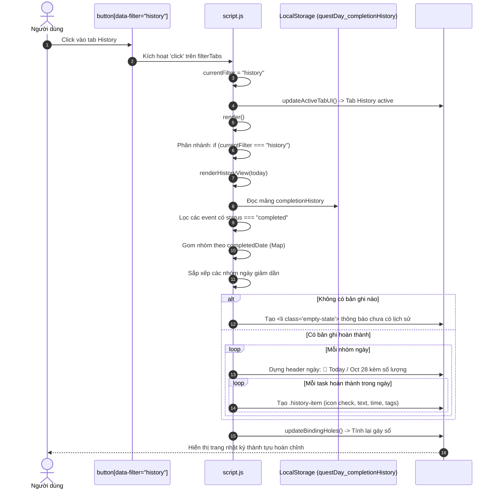
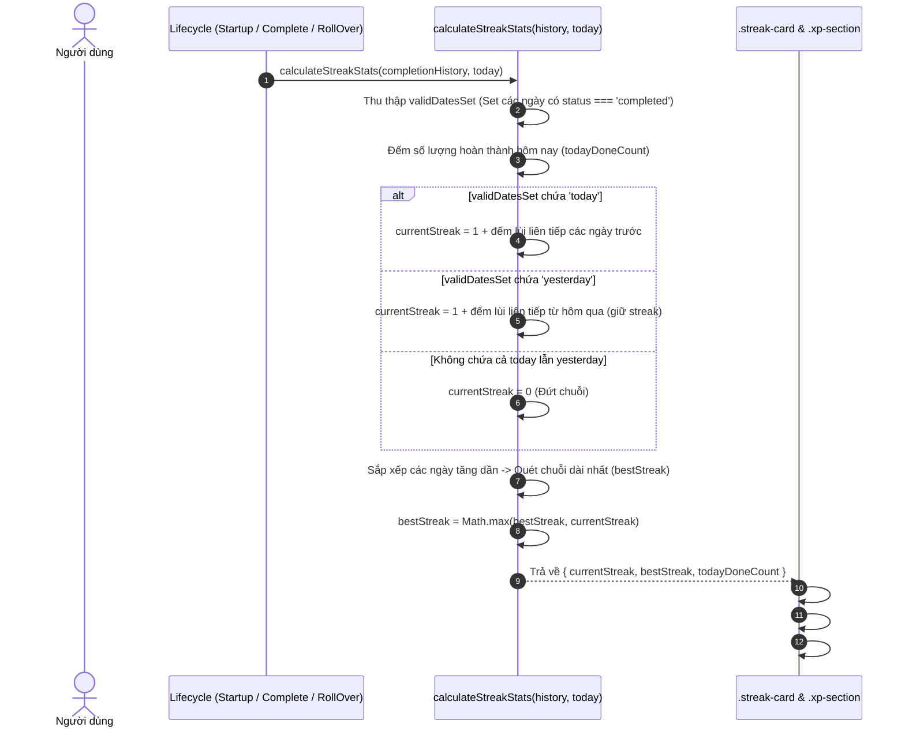

# [F11–F12] Lịch Sử Hoàn Thành & Chuỗi Ngày Liên Tục (History & Daily Streak)

> **Mã Flow:** F11, F12  
> **Tài liệu cha:** [USER-FLOWS.md](../USER-FLOWS.md)  
> **Mã nguồn liên quan:** [`script.js`](../../script.js) | [`index.html`](../../index.html) | [`style.css`](../../style.css)

Tài liệu này bao quát các luồng tương tác thuộc **Milestone M02 — Quest History, Daily Streak & XP Progress**: cơ chế lưu trữ lịch sử hoàn thành độc lập (`questDay_completionHistory`), hiển thị danh sách nhật ký hoàn thành theo từng ngày thực tế, thuật toán tính chuỗi ngày làm việc liên tiếp (`Daily Streak`), và duy trì thành tựu ngay cả khi nhiệm vụ gốc bị xóa.

---

## 📋 Danh Sách Các Luồng Tương Tác Trong Nhóm

- **[F11: Người dùng xem Lịch sử hoàn thành (Open Quest History)](#f11-người-dùng-xem-lịch-sử-hoàn-thành-open-quest-history)**
- **[F12: Người dùng theo dõi chuỗi ngày Streak (View Daily Streak)](#f12-người-dùng-theo-dõi-chuỗi-ngày-streak-view-daily-streak)**

---

## F11: Người dùng xem Lịch sử hoàn thành (Open Quest History)

### A. User Scenario & Preconditions
- **Bối cảnh & Vị trí:** Người dùng muốn nhìn lại thành quả lao động của mình trong quá khứ, đang đứng ở bất kỳ màn hình nào trong ứng dụng.
- **Thao tác:** Người dùng click vào tab **`History`** trên thanh điều hướng (`.filter-tabs`).
- **Tiền điều kiện:** Ứng dụng đã nạp danh sách `completionHistory` từ LocalStorage. Có thể đã có hoặc chưa có nhiệm vụ nào được hoàn thành.
- **Kết quả kỳ vọng:**
  - Tab `History` chuyển sang trạng thái Active.
  - Danh sách `#questList` chuyển sang chế độ xem nhật ký lịch sử: các nhiệm vụ hoàn thành hợp lệ được nhóm theo ngày (`completedDate`) giảm dần (ngày gần nhất xếp trên cùng).
  - Trong cùng một ngày, các nhiệm vụ hoàn thành sau xếp trước (theo `completedAt`).
  - Mỗi mục thể hiện: dấu tích xanh, tên công việc, giờ hoàn thành (`⏰ 14:30`), nhãn kế hoạch/deadline gốc.
  - Các nhiệm vụ đã bị xóa khỏi danh sách Todo vẫn hiển thị trong lịch sử với nhãn `✕ Archived`.
  - Toàn bộ giao diện History là **chỉ đọc (Read-Only)**; không cho phép kích hoạt checkbox, favorite, inline edit hay delete.

### B. Actual Execution Flow


### C. Step-by-Step Source Walkthrough
1. **Lắng nghe sự kiện click tab:**
   - Dòng 465–477 trong [`script.js`](../../script.js): Khi người dùng click tab có `data-filter="history"`, biến `currentFilter` nhận giá trị `"history"`, gọi `updateActiveTabUI()` và `render()`.
2. **Tách biệt luồng Render (Architecture Separation):**
   - Dòng 217–227 trong [`script.js`](../../script.js):
     ```javascript
     if (currentFilter === "history") {
       renderHistoryView(today);
     } else {
       renderTasksView(today);
     }
     ```
   - Nhờ phân tách rạch ròi, `renderHistoryView()` không dùng template `questItemTemplate` của task mà tự dựng cấu trúc cây DOM riêng biệt.
3. **Thuật toán gom nhóm & Sắp xếp trong [`renderHistoryView()`](../../script.js) (Dòng 244–337):**
   - **Lọc event hợp lệ:** `completionHistory.filter(e => e.status === "completed")`. Các event bị đánh dấu `status === "undone"` bị loại bỏ hoàn toàn khỏi màn hình hiển thị.
   - **Xử lý Legacy Completed:** Nếu có task cũ có `completed: true` nhưng thiếu bản ghi history, hệ thống gom vào nhóm đặc biệt `"unknown"` mang nhãn `Completed — Date Unknown` và gắn tag `Legacy Record`.
   - **Sắp xếp nhóm ngày:** `Array.from(groups.keys()).sort((a, b) => b.localeCompare(a))` đảm bảo ngày mới nhất luôn ở đỉnh trang sổ.
   - **Sắp xếp trong ngày:** Các mục trong từng nhóm được sắp xếp theo chuỗi thời gian ISO `b.completedAt.localeCompare(a.completedAt)`.
4. **Bảo mật XSS & An toàn DOM:**
   - Dòng 331 trong [`script.js`](../../script.js): `itemEl.querySelector(".history-text").textContent = entry.text;` sử dụng `textContent` an toàn tuyệt đối thay vì nội suy chuỗi HTML trực tiếp.
5. **Chốt an toàn Read-Only:**
   - Dòng 482 và 614 trong [`script.js`](../../script.js): Đặt guard clause `if (currentFilter === "history") return;` ở đầu cả hai listener `click` và `dblclick` trên `#questList`, ngăn chặn mọi hành vi click nhầm làm thay đổi trạng thái của task.

### D. State & LocalStorage Changes
- **In-Memory State:** `currentFilter = "history"`. Mảng `tasks` và `completionHistory` không bị thay đổi.
- **LocalStorage:** Hoàn toàn không ghi đè hay thay đổi bất kỳ khóa storage nào.

### E. Visible UI Result
- Màn hình sổ tay hiển thị các khối nhật ký theo ngày cổ điển (`.history-group`).
- Đầu mỗi ngày là tiêu đề ngày kẻ nét đứt retro: `📅 Oct 29, 2026 — 2 completed`.
- Mỗi dòng là một tấm thẻ màu giấy ngà (`.history-item`) với dấu tích xanh lá `✓`, giờ hoàn thành chính xác và các nhãn ngày ban đầu. Nếu Quest gốc đã bị xóa, xuất hiện thêm nhãn `✕ Archived`.

### F. Edge Cases
- **Lịch sử hoàn toàn rỗng:** Hiển thị thông điệp trống thân thiện: *"No completed quests recorded yet. Complete a quest to start your journey! ✨"*.
- **Quest hoàn thành rồi bị xóa khỏi Todo:** Nhờ trường `deletedAt`, bản ghi vẫn nằm nguyên trong History và vẫn đóng góp vào chuỗi Streak.

### G. Debug Guide
- Đặt breakpoint tại dòng 244 [`script.js`](../../script.js) trong hàm `renderHistoryView()`.
- Thêm Watch: `completionHistory`, `validEvents.length`, `groups`.

---

## F12: Người dùng theo dõi chuỗi ngày Streak (View Daily Streak)

### A. User Scenario & Preconditions
- **Bối cảnh & Vị trí:** Người dùng nhìn vào khu vực thống kê Streak (`.streak-section`) nằm ngay dưới thanh tiến trình XP ở đầu cuốn sổ tay.
- **Thao tác:** Người dùng quan sát 3 chỉ số hiển thị:
  1. `🔥 STREAK`: Số ngày liên tiếp hoàn thành nhiệm vụ tính đến hiện tại.
  2. `🏆 BEST`: Kỷ lục chuỗi ngày dài nhất từng đạt được.
  3. `✨ TODAY`: Số lượng nhiệm vụ đã hoàn thành trong ngày hôm nay.
- **Tiền điều kiện:** Ứng dụng đã nạp lịch sử hoàn thành hợp lệ.
- **Kết quả kỳ vọng:**
  - Nếu hôm nay đã hoàn thành ít nhất 1 quest: Streak tăng lên phản ánh cả ngày hôm nay.
  - Nếu hôm nay chưa hoàn thành nhưng hôm qua có hoàn thành: Streak giữ nguyên số ngày tính đến hết hôm qua (người dùng chưa bị đứt chuỗi).
  - Nếu cả hôm nay và hôm qua đều không có quest hoàn thành: Streak trở về `0 days`.
  - Kỷ lục `BEST` luôn lưu giữ chuỗi dài nhất trong toàn bộ lịch sử.

### B. Actual Execution Flow


### C. Step-by-Step Source Walkthrough
1. **Thuật toán cốt lõi trong [`calculateStreakStats()`](../../script.js) (Dòng 149–199):**
   - **Tập hợp ngày hợp lệ (Set Deduplication):**
     ```javascript
     const validDatesSet = new Set();
     for (const entry of history) {
       if (entry.status === "completed" && isValidDateString(entry.completedDate)) {
         validDatesSet.add(entry.completedDate);
         if (entry.completedDate === today) todayDoneCount++;
       }
     }
     ```
     Dùng `Set` đảm bảo dù trong 1 ngày người dùng hoàn thành 1 việc hay 10 việc thì ngày đó cũng chỉ được tính đúng 1 lần cho chuỗi Streak.
   - **Xác định Current Streak theo mốc hôm nay & hôm qua:**
     - Sử dụng hàm lùi ngày chuẩn Date API: [`getPreviousDateString(dateStr)`](../../script.js) (dòng 52–57).
     - Nếu `validDatesSet.has(today)`: Bắt đầu từ 1, lặp lùi ngày kiểm tra `while (validDatesSet.has(checkDate))` để cộng dồn.
     - Nếu không có hôm nay nhưng `validDatesSet.has(yesterday)`: Người dùng vẫn còn cơ hội hoàn thành việc trong ngày hôm nay trước nửa đêm mà không bị mất chuỗi; Streak tiếp tục tính từ hôm qua.
     - Nếu cả hai ngày đều vắng bóng: `currentStreak = 0`.
   - **Xác định Best Streak:**
     - Chuyển `validDatesSet` thành mảng `sortedDates = Array.from(validDatesSet).sort()`.
     - Dùng hàm tiến ngày [`getNextDateString()`](../../script.js) để duyệt tìm đoạn nối tiếp dài nhất (`currentRun`).
2. **Cập nhật giao diện trong [`updateStreakUI()`](../../script.js) (Dòng 201–212):**
   - Đồng bộ giá trị vào `#currentStreak`, `#bestStreak`, `#todayCompletedCount`.
   - Tự động thêm số nhiều: `1 day` vs `2 days`.

### D. State & LocalStorage Changes
- Streak là **dữ liệu phái sinh thuần túy (Pure Derived State)** được tính toán tức thì từ `completionHistory` và ngày hiện tại. Không lưu biến riêng vào LocalStorage, đảm bảo tính nhất quán tuyệt đối và không bao giờ bị lệch dữ liệu (Desync).

### E. Visible UI Result
- Thẻ Streak Card cổ điển hiển thị 3 cột thông tin ngăn cách bởi vạch đứt mỏng:
  - `🔥 STREAK: 3 days`
  - `🏆 BEST: 5 days`
  - `✨ TODAY: 2 done`
- Dưới thanh XP, nhãn phụ hiển thị số điểm cần để thăng cấp: `85 XP to Level 2`.

### F. Edge Cases
- **Hoàn tác nhiệm vụ (Uncomplete):** Event chuyển sang `status: "undone"`. Hàm `calculateStreakStats` ngay lập tức loại bỏ ngày đó nếu ngày đó không còn nhiệm vụ hoàn thành nào khác.
- **Ranh giới tháng/năm và năm nhuận:** Hàm `getPreviousDateString` và `getNextDateString` khởi tạo qua `new Date(y, m - 1, d)` rồi dùng `setDate()` nguyên bản của JS, tự động tính đúng ngày 28/2 sang 29/2 (năm nhuận) và 31/12 sang 01/01.

### G. Debug Guide
- Đặt breakpoint tại dòng 150 [`script.js`](../../script.js) trong hàm `calculateStreakStats()`.
- Thử nghiệm nhanh trong Console:
  ```javascript
  calculateStreakStats([
    { status: "completed", completedDate: "2026-10-28" },
    { status: "completed", completedDate: "2026-10-29" }
  ], "2026-10-29");
  ```

---

## H. Manual Tests

| Bước | Thao tác thực hiện | Kết quả mong đợi |
| :---: | :--- | :--- |
| **1** | Mới vào app chưa có nhiệm vụ hoàn thành. | Streak hiển thị `0 days`, Best `0 days`, Today `0 done`. |
| **2** | Tích checkbox hoàn thành 1 Quest bất kỳ. | Streak nhảy lên `1 day`, Best `1 day`, Today `1 done`. Có ngôi sao bay và +10 XP. |
| **3** | Chuyển sang tab `History`. | Thấy nhiệm vụ vừa hoàn thành nằm trong nhóm `📅 Today` kèm giờ hoàn thành. |
| **4** | Bỏ tích (Uncomplete) nhiệm vụ đó ở tab Today. | Streak quay về `0 days`, Today `0 done`. Vào tab History xác nhận nhiệm vụ biến mất khỏi danh sách hợp lệ. |
| **5** | Tích hoàn thành lại nhiệm vụ đó. | Streak trở lại `1 day`, tạo bản ghi lịch sử mới, nhưng **không cộng thêm 10 XP** lần thứ hai. |
| **6** | Xóa nhiệm vụ đó khỏi TodoList (`✕`). | Nhiệm vụ biến mất khỏi Todo, nhưng vào tab History vẫn thấy hiển thị với nhãn `✕ Archived`, Streak vẫn giữ `1 day`. |

---

## I. Learning Questions

1. **Tại sao Streak lại được tính toán động (Computed on-the-fly) từ mảng `completionHistory` mà không lưu một biến số `currentStreak` vào LocalStorage?**  
   *Trả lời:* Vì Streak phụ thuộc vào dòng thời gian thực tế của thế giới bên ngoài (ngày hôm nay so với ngày hoàn thành nhiệm vụ). Nếu lưu một con số tĩnh vào LocalStorage, khi người dùng không mở app 3 ngày rồi quay lại, con số đó vẫn là số cũ nếu không có bộ đếm ngầm phức tạp. Tính toán động từ lịch sử đảm bảo tính trung thực (truthful state): chỉ cần biết hôm nay là ngày mấy, hàm tính toán sẽ cho ra kết quả chính xác 100%.
2. **Khi người dùng hoàn tác (Uncomplete) một Quest, tại sao không xóa hẳn bản ghi khỏi mảng `completionHistory` mà lại dùng cờ `status: "undone"`?**  
   *Trả lời:* Đây là nguyên lý "Soft Invalidation" trong thiết kế hệ thống ghi vết (Audit Logging). Giữ lại bản ghi với cờ `undone` và timestamp `undoneAt` bảo toàn toàn bộ dấu vết thao tác của người dùng, tránh lỗi mất dữ liệu ngẫu nhiên và cho phép hỗ trợ tính năng khôi phục/nhật ký nâng cao trong tương lai.
3. **Tại sao tab History phải áp dụng cơ chế Read-Only và chặn Event Delegation từ danh sách nhiệm vụ?**  
   *Trả lời:* Vì các mục trong History đại diện cho những thành tựu đã được hoàn thành trong quá khứ (kể cả những việc đã bị xóa khỏi danh sách Todo). Nếu cho phép click checkbox hay inline-edit trên thẻ History, nó sẽ làm gãy tính toàn vẹn của lịch sử và xung đột logic với mảng công việc hiện tại.

