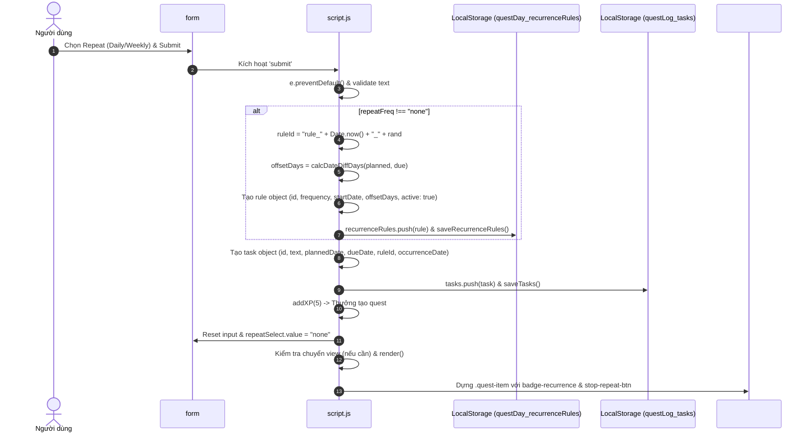
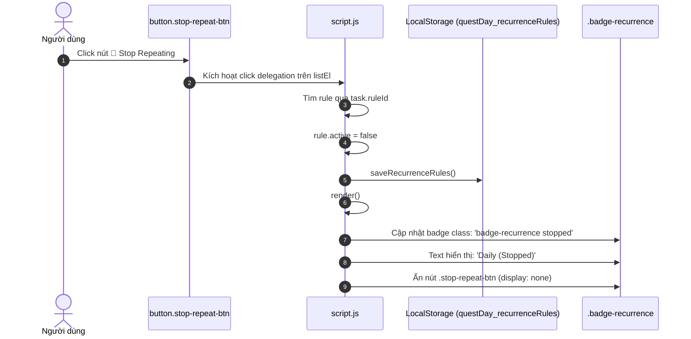

# [F13–F17] Nhiệm Vụ Lặp Lại & Tự Động Tái Tạo (Recurring Quests & Lazy Rollover)

> **Mã Flow:** F13, F14, F15, F16, F17  
> **Tài liệu cha:** [USER-FLOWS.md](../USER-FLOWS.md)  
> **Mã nguồn liên quan:** [`script.js`](../../script.js) | [`index.html`](../../index.html) | [`style.css`](../../style.css)

Tài liệu này bao quát toàn bộ cơ chế nghiệp vụ và luồng thực thi của **Milestone M03 — Recurring Quest**: mô hình quy tắc lặp độc lập (`questDay_recurrenceRules`), cơ chế tự động phát sinh nhiệm vụ theo yêu cầu (Lazy Generation), bảo toàn hạn chót tương đối (Relative Deadline Offset), nguyên tắc tối đa 1 lượt chưa hoàn thành (Carry-over without flood), dừng lặp và xóa lượt an toàn, cùng với chốt bảo vệ hoàn tác (Undo Guard) và toàn vẹn điểm thưởng XP.

---

## 📋 Danh Sách Các Luồng Tương Tác Trong Nhóm

- **[F13: Người dùng tạo Quest lặp lại (Create Recurring Quest)](#f13-người-dùng-tạo-quest-lặp-lại-create-recurring-quest)**
- **[F14: Tự động phát sinh lượt nhiệm vụ tiếp theo (Lazy Occurrence Generation & Carry-over)](#f14-tự-động-phát-sinh-lượt-nhiệm-vụ-tiếp-theo-lazy-occurrence-generation--carry-over)**
- **[F15: Người dùng dừng lặp nhiệm vụ (Stop Repeating Quest)](#f15-người-dùng-dừng-lặp-nhiệm-vụ-stop-repeating-quest)**
- **[F16: Người dùng xóa một lượt nhiệm vụ lặp (Delete Recurring Occurrence)](#f16-người-dùng-xóa-một-lượt-nhiệm-vụ-lặp-delete-recurring-occurrence)**
- **[F17: Hoàn thành lượt nhiệm vụ & Chốt an toàn hoàn tác (Complete, Undo Guard & XP Rules)](#f17-hoàn-thành-lượt-nhiệm-vụ--chốt-an-toàn-hoàn-tác-complete-undo-guard--xp-rules)**

---

## F13: Người dùng tạo Quest lặp lại (Create Recurring Quest)

### A. User Scenario
- **Bối cảnh & Vị trí:** Người dùng đang ở màn hình chính của ứng dụng và muốn thiết lập một thói quen hằng ngày (ví dụ: *Tập thể dục buổi sáng*) hoặc hằng tuần (ví dụ: *Họp tổng kết tuần*).
- **Thao tác:**
  1. Nhập tên nhiệm vụ vào ô input `#questInput`.
  2. Chọn ngày bắt đầu tại `#plannedInput` (mặc định là Today) và deadline tại `#dueInput` (tùy chọn).
  3. Chọn tần suất lặp tại `#repeatSelect`: **`Daily`** (hằng ngày) hoặc **`Weekly`** (hằng tuần).
  4. Nhấn Enter hoặc click nút Submit (+) `#addBtn`.
- **Tiền điều kiện:** Ô nhập tên không được để trống (sau khi `.trim()`).
- **Kết quả kỳ vọng:**
  - Một quy tắc lặp mới được lưu vào `questDay_recurrenceRules`.
  - Lượt nhiệm vụ đầu tiên (`occurrenceDate = plannedDate`) được tạo ngay và thêm vào mảng `tasks`.
  - Người dùng nhận **+5 XP** (điểm thưởng tạo quest ban đầu).
  - Form nhập liệu được reset (tần suất quay về `None`).
  - Giao diện hiển thị Quest kèm huy hiệu lặp `🔁 Daily` hoặc `🔁 Weekly` và nút Dừng lặp `🚫`.

### B. Actual Execution Flow


### C. Source Code Walkthrough
- **File:** [`script.js`](../../script.js)
- **Hàm:** `form.addEventListener("submit", (e) => ...)`
- **Các bước thực thi:**
  1. Kiểm tra giá trị `repeatFreq = repeatSelect ? repeatSelect.value : "none"`.
  2. Nếu là `"daily"` hoặc `"weekly"`, sinh `ruleId` độc nhất.
  3. Tính khoảng cách deadline tương đối `offsetDays = planned && due ? calcDateDiffDays(planned, due) : null`.
  4. Tạo bản ghi `rule` lưu vào `recurrenceRules` và đồng bộ qua [`saveRecurrenceRules()`](../../script.js).
  5. Tạo đối tượng `task` mang `ruleId` và `occurrenceDate = planned || today`.
  6. Lưu vào `tasks` qua [`saveTasks()`](../../script.js), gọi `addXP(5)`.
  7. Reset ô chọn lặp về `"none"` và render giao diện qua [`render()`](../../script.js).

### D. State and LocalStorage
- **In-Memory State:**
  - `recurrenceRules.length` tăng thêm 1.
  - `tasks.length` tăng thêm 1.
  - `xp` tăng thêm 5.
- **LocalStorage Keys:**
  - `questDay_recurrenceRules`: Mảng JSON chứa các quy tắc lặp.
  - `questLog_tasks`: Mảng JSON chứa các task bao gồm trường `ruleId` và `occurrenceDate`.
  - `questLog_xp`: Số nguyên tăng thêm 5.

### E. UI Update
- Thẻ nhiệm vụ mới xuất hiện trong danh sách `#questList`.
- Phần metadata có thêm huy hiệu: `<span class="meta-tag badge-recurrence"><svg class="retro-icon badge-icon"><use href="#icon-repeat"/></svg> Daily</span>`.
- Nút bấm dừng lặp hiển thị cạnh nút sửa ngày: `<button class="icon-btn stop-repeat-btn" title="Stop repeating (cancel future recurrence)"><svg><use href="#icon-repeat-off"/></svg></button>`.

### F. Edge Cases & Known Behaviors
- **Người dùng không chọn ngày kế hoạch:** Hệ thống tự gán `startDate = today` để đảm bảo chu kỳ lặp có mốc xuất phát rõ ràng.
- **Người dùng không chọn deadline:** Trường `dueDateOffsetDays` lưu `null`, các lượt phát sinh tiếp theo sẽ không có deadline cưỡng ép.

### G. Debug Guide
- Đặt Breakpoint tại dòng xử lý `form.addEventListener("submit")` trong [`script.js`](../../script.js).
- Watch Expressions: `repeatSelect.value`, `recurrenceRules`, `tasks[tasks.length - 1]`.

### H. Manual Test Steps
1. Mở trang, nhập: "Morning Workout".
2. Chọn Repeat: "Daily", Plan: Hôm nay, Due: Ngày mai.
3. Nhấn Submit.
4. **Kết quả kỳ vọng:** Xuất hiện task có badge `Daily`, nhãn `Plan: Today`, `Due: Tomorrow`, nút `🚫` dừng lặp hiển thị, XP tăng +5.

### I. Learning Check
- *Câu hỏi 1:* Tại sao `dueDateOffsetDays` được lưu dưới dạng khoảng cách ngày (số nguyên) thay vì lưu ngày deadline cố định trong rule?
- *Đáp án:* Vì các lượt phát sinh ở ngày `T` trong tương lai sẽ có hạn chót dịch chuyển tương ứng là `T + offsetDays`.

---

## F14: Tự động phát sinh lượt nhiệm vụ tiếp theo (Lazy Occurrence Generation & Carry-over)

### A. User Scenario
- **Bối cảnh & Vị trí:** Người dùng đã tạo một nhiệm vụ lặp Daily và đã hoàn thành lượt của hôm nay. Ngày hôm sau, người dùng mở lại trang web hoặc chuyển tab quay lại ứng dụng.
- **Thao tác:** Người dùng mở ứng dụng (F5, khởi động trình duyệt, hoặc focus vào tab đang mở).
- **Tiền điều kiện:** Lượt hôm trước đã được đánh dấu `completed = true` (hoặc đã bị xóa nhưng đã ghi nhận hoàn thành).
- **Kết quả kỳ vọng:**
  - Ứng dụng tự động sinh 1 lượt nhiệm vụ mới cho ngày hôm nay (`plannedDate = today`).
  - Hạn chót mới được tính theo offset ban đầu (`dueDate = today + offsetDays`).
  - Lượt tự động sinh **không được thưởng XP tạo nhiệm vụ (+0 XP)**.
  - **Quy tắc Carry-over (Không ngập lụt nhiệm vụ):** Nếu lượt hôm trước chưa hoàn thành, hệ thống **không sinh thêm lượt mới** mà giữ nguyên nhiệm vụ cũ làm việc tồn đọng (Carry-over).

### B. Actual Execution Flow
```mermaid
flowchart TD
    A["Sự kiện Kích hoạt<br/>(Startup init / Focus tab / Midnight rollover)"] --> B["Gọi processRecurrenceRules(todayStr)"]
    B --> C{"Duyệt từng rule trong recurrenceRules"}
    C -->|rule.active === false| D["Bỏ qua (Đã dừng lặp)"]
    C -->|todayStr < rule.startDate| D
    C -->|Weekly: sai thứ trong tuần| D
    C -->|rule.lastGeneratedDate === todayStr| D["Bỏ qua (Đã tạo hôm nay)"]
    C -->|Đã có task plannedDate === todayStr| D
    C -->|Còn task incomplete (Pending)| E["Giữ làm Carry-over<br/>(Tối đa 1 pending / rule)"]
    C -->|Đã hoàn thành hôm nay trong tasks/history| D["Bỏ qua (Mỗi ngày chỉ 1 lượt)"]
    C -->|Thỏa mãn toàn bộ điều kiện| F["Tạo newOccurrence<br/>id: uid(), plannedDate: todayStr,<br/>dueDate: todayStr + offset,<br/>ruleId: rule.id, completed: false"]
    F --> G["tasks.push(newOccurrence)"]
    F --> H["rule.lastGeneratedDate = todayStr"]
    G & H --> I["saveTasks() & saveRecurrenceRules()<br/>(LƯU Ý: Không gọi addXP)"]
    I --> J["render() -> Hiển thị trên giao diện"]
```

### C. Step-by-Step Source Walkthrough
- **File:** [`script.js`](../../script.js)
- **Hàm:** `processRecurrenceRules(todayStr)` (được gọi từ `init()` và `checkDateRollOver()`).
- **Các bước kiểm tra an toàn (Safety Gates):**
  1. `if (!rule.active) continue;` — Quy tắc đã dừng sẽ không bao giờ sinh thêm lượt.
  2. `if (rule.frequency === "weekly")` — Kiểm tra hàm `getDayOfWeek(todayStr) === getDayOfWeek(rule.startDate)`.
  3. `if (rule.lastGeneratedDate === todayStr) continue;` — Chống tạo trùng khi F5 hoặc gọi nhiều lần trong cùng 1 ngày.
  4. `const hasPending = tasks.some(t => t.ruleId === rule.id && !t.completed); if (hasPending) continue;` — **Bảo toàn Carry-over:** Ngăn chặn hiện tượng tạo dồn dập hàng loạt task chưa hoàn thành nếu người dùng vắng mặt nhiều ngày.
  5. `tasks.push(newOccurrence); rule.lastGeneratedDate = todayStr;` — Lưu trực tiếp và cập nhật mốc phát sinh.

### D. State and LocalStorage
- **In-Memory State:** `tasks` nhận thêm 1 phần tử mới. Điểm `xp` không thay đổi (+0 XP).
- **LocalStorage:** Đồng bộ mảng `tasks` vào `questLog_tasks` và `rule.lastGeneratedDate` vào `questDay_recurrenceRules`.

### E. UI Update
- Lượt nhiệm vụ mới xuất hiện trong bộ lọc Today với nhãn `Plan: Today`, checkbox rỗng, huy hiệu lặp và nút Dừng lặp.

### F. Edge Cases
- **Vắng mặt 10 ngày:** Khi người dùng quay lại sau 10 ngày, hệ thống chỉ duy trì đúng 1 lượt tồn đọng (Carry-over) chứ không sinh 10 nhiệm vụ giống hệt nhau làm vỡ giao diện cuốn sổ.

---

## F15: Người dùng dừng lặp nhiệm vụ (Stop Repeating Quest)

### A. User Scenario
- **Bối cảnh & Vị trí:** Người dùng không còn muốn tiếp tục lặp lại thói quen này nữa.
- **Thao tác:** Click vào biểu tượng **`🚫` (Stop Repeating)** trên thẻ nhiệm vụ.
- **Tiền điều kiện:** Nhiệm vụ thuộc một quy tắc lặp đang kích hoạt (`rule.active === true`).
- **Kết quả kỳ vọng:**
  - Quy tắc lặp chuyển sang trạng thái vô hiệu hóa (`rule.active = false`).
  - Huy hiệu lặp chuyển sang màu xám mờ với chữ: **`Daily (Stopped)`** hoặc **`Weekly (Stopped)`**.
  - Nút bấm `🚫` tự động biến mất.
  - Nhiệm vụ hiện tại vẫn giữ nguyên cho đến khi người dùng làm xong hoặc xóa.
  - Trong tương lai, hệ thống sẽ **không bao giờ tự động phát sinh** thêm lượt nào cho quy tắc này nữa.

### B. Actual Execution Flow


### C. Source Code Walkthrough
- **File:** [`script.js`](../../script.js)
- **Hàm:** `listEl.addEventListener("click", (e) => ...)`
- **Đoạn mã then chốt:**
  ```javascript
  if (e.target.closest(".stop-repeat-btn")) {
    const rule = recurrenceRules.find((r) => r.id === task.ruleId);
    if (rule) {
      rule.active = false;
      saveRecurrenceRules();
      render();
    }
    return;
  }
  ```
- **Hàm Render liên đới:** Trong [`renderItem()`](../../script.js), kiểm tra `rule.active`: nếu `false` thì gắn class `.badge-recurrence.stopped` và ẩn nút `.stop-repeat-btn`.

---

## F16: Người dùng xóa một lượt nhiệm vụ lặp (Delete Recurring Occurrence)

### A. User Scenario
- **Bối cảnh & Vị trí:** Người dùng hôm nay không muốn thực hiện lượt nhiệm vụ này và muốn xóa nó đi, nhưng không muốn hủy bỏ chu kỳ lặp của những ngày sau.
- **Thao tác:** Click vào biểu tượng thùng rác **`🗑` (.delete-btn)** trên thẻ nhiệm vụ.
- **Kết quả kỳ vọng:**
  - Chỉ lượt nhiệm vụ hiện tại bị xóa khỏi danh sách `tasks`.
  - Quy tắc lặp trong `questDay_recurrenceRules` **vẫn được bảo toàn nguyên vẹn**.
  - Lịch sử các lần hoàn thành trong quá khứ không bị ảnh hưởng.
  - Ngày hôm sau, chu kỳ lặp vẫn tiếp tục phát sinh lượt mới bình thường.

### B. State & Persistence Separation
- Xóa task chỉ tác động vào `questLog_tasks`.
- Tuyệt đối không xóa hay sửa đổi các khóa `questDay_recurrenceRules` hay `questDay_completionHistory`.

---

## F17: Hoàn thành lượt nhiệm vụ & Chốt an toàn hoàn tác (Complete, Undo Guard & XP Rules)

### A. User Scenario & Integrity Guards
- **Hoàn thành lượt (Complete):**
  - Click vào checkbox tròn: nhiệm vụ chuyển sang gạch ngang, ghi nhận vào `questDay_completionHistory` kèm `ruleId`.
  - Người dùng nhận **+10 XP** cho lần hoàn thành đầu tiên của lượt này.
  - Trong cùng 1 ngày, hoàn thành 1 lượt sẽ chặn không cho hệ thống sinh thêm lượt thứ 2 trong ngày.
- **Chốt an toàn hoàn tác (Undo Guard):**
  - Giả sử hôm nay là ngày 31, hệ thống đã sinh lượt mới của ngày 31.
  - Nếu người dùng vào tab **All** và cố tình click bỏ dấu tích hoàn thành của lượt cũ ngày 30:
  - Hệ thống sẽ **ngăn chặn hành vi hoàn tác** và hiển thị cảnh báo:
    > *"Cannot undo a completed quest when a newer recurring occurrence already exists."*
  - Mục đích kỹ thuật: Ngăn chặn xung đột trạng thái (state conflict) khiến 1 quy tắc lặp có 2 lượt pending cùng lúc, bảo vệ tính toàn vẹn của chuỗi chu kỳ lặp.

### B. Source Code Walkthrough
- **File:** [`script.js`](../../script.js) -> `listEl.addEventListener("click")`:
  ```javascript
  if (task.ruleId) {
    const newerExists = tasks.some(
      (t) =>
        t.ruleId === task.ruleId &&
        t.id !== task.id &&
        ((t.occurrenceDate || "") > (task.occurrenceDate || "") ||
          (t.plannedDate || "") > (task.plannedDate || ""))
    );
    if (newerExists) {
      alert("Cannot undo a completed quest when a newer recurring occurrence already exists.");
      return;
    }
  }
  ```

---

## G. Debug Guide

1. **Kiểm tra phát sinh lặp trong DevTools Console:**
   - Mở Console (`F12`), gõ:
     ```javascript
     // Mô phỏng sang ngày mai để kích hoạt phát sinh lặp:
     processRecurrenceRules("2026-10-31");
     render();
     ```
   - Quan sát danh sách `tasks` và xem lượt mới có xuất hiện trong tab Today/Upcoming hay không.
2. **Kiểm tra Storage:**
   - `JSON.parse(localStorage.getItem("questDay_recurrenceRules"))` để xem danh sách quy tắc và cờ `active`.
   - `JSON.parse(localStorage.getItem("questDay_completionHistory"))` để xem trường `ruleId` trong các bản ghi lịch sử.
3. **Các điểm đặt Breakpoint:**
   - Hàm `processRecurrenceRules()` tại dòng bắt đầu vòng lặp `for (const rule of recurrenceRules)`.
   - Sự kiện click `.stop-repeat-btn` trong delegation listener của `listEl`.
   - Điều kiện kiểm tra `newerExists` trong nhánh uncomplete của `checkbox`.

---

## H. Manual Test Steps

1. **Bước 1: Tạo Quest lặp Daily:**
   - Nhập "Uống 2 lít nước", chọn Repeat: "Daily", Plan: Hôm nay, Due: Hôm nay. Bấm (+).
   - *Kỳ vọng:* Task xuất hiện, có badge `Daily`, nút `🚫` hiển thị, XP tăng +5.
2. **Bước 2: Hoàn thành lượt hôm nay:**
   - Bấm checkbox hoàn thành.
   - *Kỳ vọng:* Task gạch ngang, XP tăng thêm +10 (tổng cộng +15 XP từ lúc tạo), lịch sử ghi nhận 1 mục có badge `Daily`.
3. **Bước 3: Dừng lặp:**
   - Bấm nút `🚫` (Stop Repeating).
   - *Kỳ vọng:* Badge chuyển thành `Daily (Stopped)` màu xám, nút `🚫` biến mất.
4. **Bước 4: Thử nghiệm hoàn tác an toàn:**
   - Tạo một quest lặp khác, hoàn thành, chuyển ngày và tạo lượt mới.
   - Thử uncomplete lượt cũ trong tab All.
   - *Kỳ vọng:* Xuất hiện thông báo alert chặn hoàn tác, task cũ giữ nguyên trạng thái hoàn thành.

---

## I. Learning Check

1. *Tại sao việc tự động sinh lượt nhiệm vụ (Lazy Generation) KHÔNG được đặt bên trong hàm `render()`?*  
   **Đáp án:** Hàm `render()` là hàm hiển thị thuần túy (UI rendering), được gọi liên tục khi chuyển tab, hover hoặc resize cửa sổ. Đặt logic sinh dữ liệu và ghi LocalStorage vào `render()` sẽ gây ra hiệu ứng phụ nghiêm trọng (side-effects), làm chậm giao diện và vi phạm nguyên lý phân tách trách nhiệm (Separation of Concerns).
2. *Khi người dùng hoàn thành một nhiệm vụ lặp, điểm XP nhận được là bao nhiêu?*  
   **Đáp án:** Chính xác là **+10 XP** cho hành động hoàn thành. Con số "+15 XP" thường thấy trong kịch bản là tổng tích lũy của 2 hành vi riêng biệt: Tạo quest (+5 XP) và Hoàn thành (+10 XP).
3. *Cơ chế Carry-over ngăn chặn lỗi ngập lụt nhiệm vụ (Catch-up Flood) như thế nào?*  
   **Đáp án:** Trước khi sinh lượt mới, hệ thống kiểm tra `tasks.some(t => t.ruleId === rule.id && !t.completed)`. Nếu còn bất kỳ lượt nào chưa hoàn thành, hệ thống sẽ bỏ qua và không sinh thêm, giữ lượt cũ làm việc tồn đọng (Carry-over), đảm bảo mỗi quy tắc lặp chỉ có tối đa 1 lượt chưa hoàn thành tại một thời điểm.

