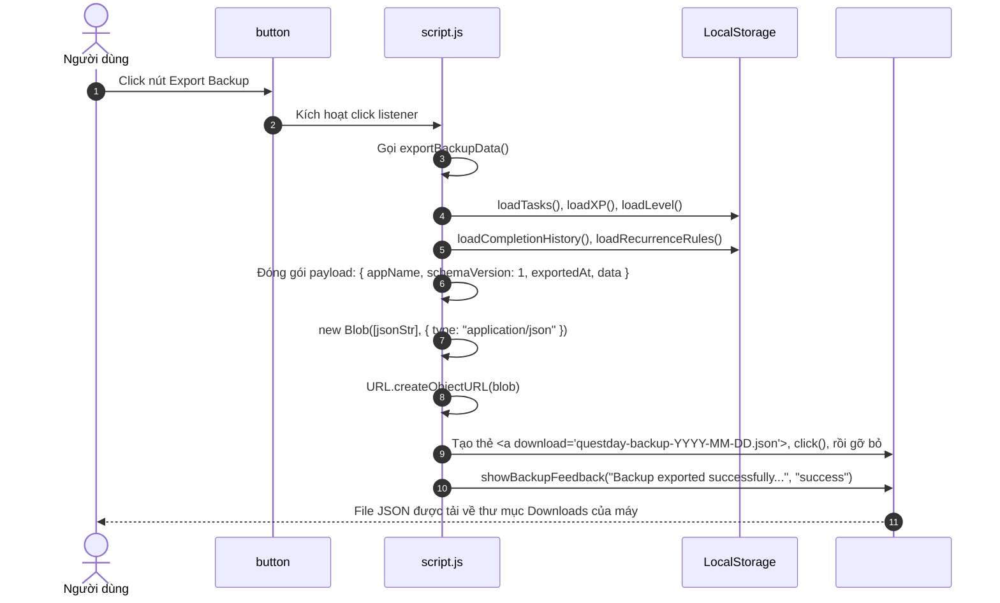
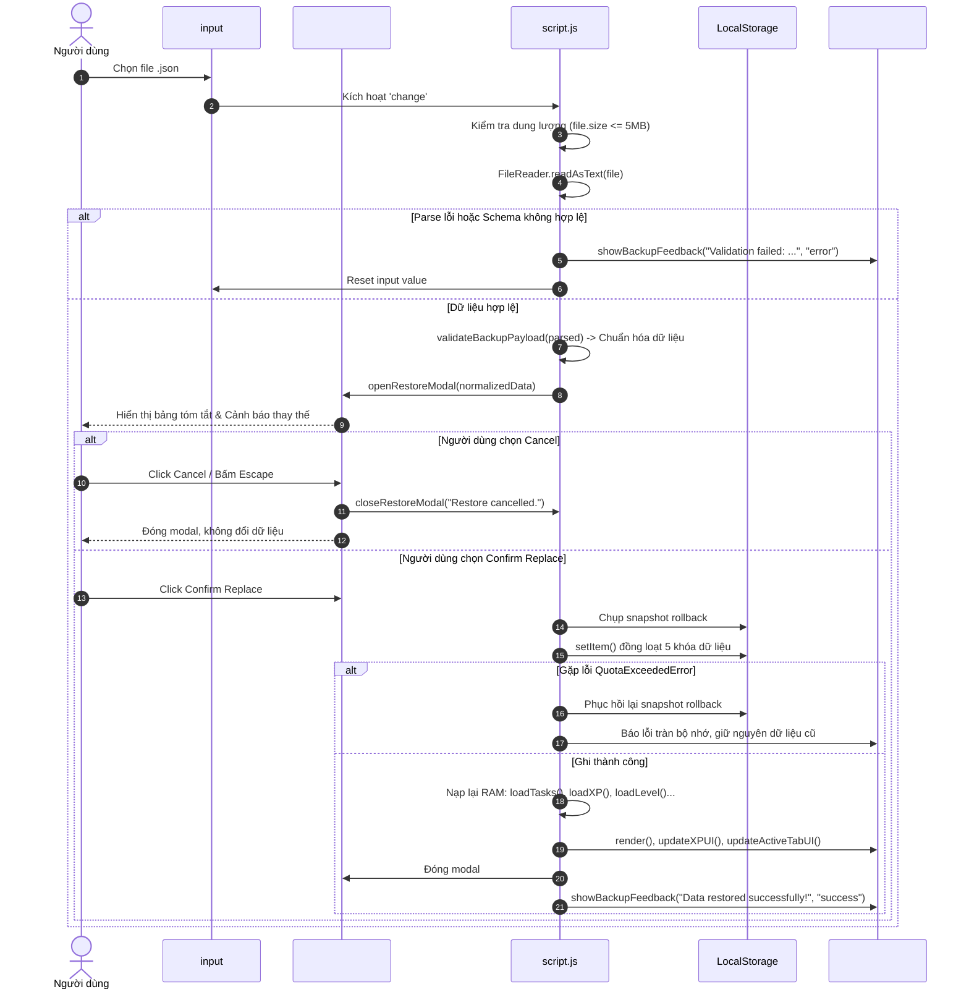

# [F18–F19] Sao Lưu & Khôi Phục Dữ Liệu (JSON Backup & Restore)

> **Mã Flow:** F18, F19  
> **Tài liệu cha:** [USER-FLOWS.md](../USER-FLOWS.md)  
> **Mã nguồn liên quan:** [`script.js`](../../script.js) | [`index.html`](../../index.html) | [`style.css`](../../style.css)

Tài liệu này bao quát các luồng tương tác thuộc **Milestone M04 — Backup, Final Polish & Release Readiness**: cơ chế trích xuất toàn bộ dữ liệu ứng dụng thành file JSON chuẩn hóa để lưu trữ offline, quy trình đọc/kiểm thử (validation) file sao lưu trước khi nạp, hộp thoại tóm tắt xác nhận trước khi thay thế dữ liệu, cơ chế tải bản sao an toàn (safety backup) và cơ chế tự động khôi phục (rollback) nếu gặp lỗi tràn bộ nhớ `QuotaExceededError`.

---

## 📋 Danh Sách Các Luồng Tương Tác Trong Nhóm

- **[F18: Người dùng xuất dữ liệu sao lưu (Export JSON Backup)](#f18-người-dùng-xuất-dữ-liệu-sao-lưu-export-json-backup)**
- **[F19: Người dùng nhập & khôi phục dữ liệu (Import & Restore Data)](#f19-người-dùng-nhập--khôi-phục-dữ-liệu-import--restore-data)**

---

## F18: Người dùng xuất dữ liệu sao lưu (Export JSON Backup)

### A. User Scenario
- **Bối cảnh & Vị trí:** Người dùng đang sử dụng ứng dụng trên trình duyệt và muốn sao lưu toàn bộ tiến trình, lịch sử, danh sách nhiệm vụ và các thói quen lặp lại để chuyển sang thiết bị khác hoặc phòng ngừa mất dữ liệu trình duyệt.
- **Thao tác:** Người dùng cuộn xuống chân trang sổ tay và click vào nút **`Export Backup`** (`#exportBackupBtn`).
- **Tiền điều kiện:** Ứng dụng đang mở trên trình duyệt; không yêu cầu kết nối Internet.
- **Kết quả kỳ vọng:**
  - Trình duyệt tự động tải xuống một file có định dạng: `questday-backup-YYYY-MM-DD.json` (ví dụ: `questday-backup-2026-10-30.json`).
  - Toàn bộ dữ liệu LocalStorage hiện tại được giữ nguyên, không bị thay đổi.
  - Phía dưới hai nút xuất hiện dòng trạng thái phản hồi tích cực màu xanh mực: *"Backup exported successfully (questday-backup-2026-10-30.json)"* và tự mờ đi sau 4.5 giây.

### B. Actual Execution Flow


### C. Step-by-Step Source Walkthrough
- **File:** [`script.js`](../../script.js) -> `function exportBackupData()`
- **Chi tiết thực thi:**
  1. Đọc dữ liệu độc lập từ 5 nguồn: `tasks`, `xp`, `level`, `completionHistory`, `recurrenceRules`.
  2. Tạo đối tượng JSON chuẩn hóa:
     ```javascript
     const payload = {
       appName: "QuestDay Todo List",
       schemaVersion: 1,
       exportedAt: new Date().toISOString(),
       data: {
         tasks: currentTasks,
         xp: currentXP,
         level: currentLevel,
         completionHistory: currentHistory,
         recurrenceRules: currentRules,
       },
     };
     ```
  3. Sử dụng `Blob` và `URL.createObjectURL(blob)` để kích hoạt tải file client-side hoàn toàn không thông qua server hay mạng Internet.
  4. Sau khi click kích hoạt, dọn dẹp URL tạm thời qua `URL.revokeObjectURL(url)`.

### D. State and LocalStorage
- **In-Memory State:** Không thay đổi bất kỳ biến nào trong RAM.
- **LocalStorage:** Hoàn toàn chỉ đọc (Read-only); không phát sinh bất kỳ thao tác ghi (`setItem`) nào.

### E. UI Update
- Thẻ `#backupFeedback` hiển thị thông báo thành công và tự động xóa sau 4.5 giây thông qua `setTimeout`.

---

## F19: Người dùng nhập & khôi phục dữ liệu (Import & Restore Data)

### A. User Scenario
- **Bối cảnh & Vị trí:** Người dùng đổi sang máy tính mới hoặc muốn khôi phục lại dữ liệu từ một bản sao lưu trước đó.
- **Thao tác:**
  1. Click vào nút **`Restore Backup`** (`#importBackupTriggerBtn`).
  2. Hộp thoại chọn file của hệ điều hành xuất hiện, người dùng chọn file backup `.json`.
  3. Hệ thống kiểm tra và mở hộp thoại xác nhận retro (`#restoreModal`) hiển thị chi tiết số lượng task, XP, cấp độ, số bản ghi lịch sử và quy tắc lặp.
  4. Người dùng có thể click **`Save Current Data First`** để lưu lại dữ liệu hiện tại trước khi ghi đè.
  5. Người dùng click **`Confirm Replace`** (`#confirmRestoreBtn`) để tiến hành khôi phục, hoặc click **`Cancel`** (`#cancelRestoreBtn`) để hủy bỏ.
- **Tiền điều kiện:** File được chọn có dung lượng hợp lệ (dưới 5MB) và có định dạng JSON.
- **Kết quả kỳ vọng:**
  - Không tự động ghi đè dữ liệu ngay khi vừa chọn file.
  - Sau khi xác nhận `Confirm Replace`, toàn bộ dữ liệu trong LocalStorage được thay thế an toàn.
  - Toàn bộ giao diện (danh sách nhiệm vụ, thanh tiến trình XP, cấp độ, chuỗi Streak, gáy sổ) được cập nhật ngay lập tức.
  - Nếu file bị lỗi cấu trúc, hệ thống thông báo lỗi chi tiết và **bảo toàn 100% dữ liệu hiện tại**.

### B. Actual Execution Flow


### C. Step-by-Step Source Walkthrough
- **File:** [`script.js`](../../script.js) -> `function validateBackupPayload()`, `openRestoreModal()`, `executeRestore()`
- **Kiểm thử tính hợp lệ (Data Validation Gates):**
  1. `payload.schemaVersion === 1`: Chỉ chấp nhận các phiên bản schema tương thích.
  2. `Array.isArray(payload.data.tasks)`: Đảm bảo danh sách nhiệm vụ là một mảng hợp lệ.
  3. Kiểm tra từng nhiệm vụ: Bắt buộc phải có `id` (string) và `text` (string).
  4. Hỗ trợ dữ liệu Legacy: Nếu backup từ các phiên bản cũ thiếu `completionHistory` hoặc `recurrenceRules`, hệ thống tự động gán mặc định là mảng rỗng `[]` thay vì báo lỗi.
- **Phòng chống tấn công XSS:**
  - Toàn bộ thông tin hiển thị trong hộp thoại `#restoreSummaryBox` được đưa vào bằng `document.createElement()` và `textContent`, tuyệt đối không dùng `innerHTML` với nội dung từ file người dùng.
- **Cơ chế Rollback an toàn (Atomicity & Rollback Protection):**
  - Trước khi ghi vào `localStorage`, hệ thống lưu bản chụp `rollbackSnapshot`. Nếu bất kỳ lệnh `setItem()` nào ném ra ngoại lệ (ví dụ: `QuotaExceededError`), hệ thống ngay lập tức hoàn tác lại trạng thái cũ từ snapshot và báo cáo giới hạn lưu trữ cho người dùng.

### D. State and LocalStorage
- **In-Memory State:**
  - `tasks`, `xp`, `level`, `completionHistory`, `recurrenceRules` nhận toàn bộ dữ liệu mới từ file backup.
  - `currentFilter` được đưa về `"today"`.
- **LocalStorage Keys:**
  - Cập nhật đồng bộ cả 5 khóa: `questLog_tasks`, `questLog_xp`, `questLog_level`, `questDay_completionHistory`, `questDay_recurrenceRules`.

### E. UI Update
- Modal xác nhận đóng lại.
- Danh sách `#questList`, thanh XP `#xpFill`, chỉ số level `#xpValue`, chuỗi ngày `#currentStreak`, và các badge số lượng trên Paper Tabs cập nhật tức thì theo dữ liệu mới.

---

## G. Debug Guide

1. **Kiểm tra hàm Export trong DevTools Console:**
   ```javascript
   // Chạy export trực tiếp từ console:
   window.exportBackupData();
   ```
2. **Kiểm tra Validation với dữ liệu giả lập:**
   ```javascript
   // Kiểm tra bắt lỗi schema:
   console.log(window.validateBackupPayload({ schemaVersion: 99 }));
   // Kết quả: { valid: false, error: "Unsupported schema version..." }
   ```
3. **Các điểm đặt Breakpoint:**
   - Dòng bắt đầu hàm `validateBackupPayload()` trong [`script.js`](../../script.js).
   - Dòng bắt đầu hàm `executeRestore()` trong [`script.js`](../../script.js).
   - Khối `catch (writeErr)` trong `executeRestore()` để kiểm tra cơ chế rollback.

---

## H. Manual Test Steps

1. **Bước 1 — Xuất bản sao lưu:**
   - Tạo 2 nhiệm vụ: "Task 1", "Task 2". Nhấn `Export Backup`.
   - *Kỳ vọng:* File `questday-backup-YYYY-MM-DD.json` tải về thành công.
2. **Bước 2 — Thay đổi dữ liệu:**
   - Xóa "Task 1", tạo "Task 3". Nhận thấy danh sách hiện tại khác với file backup.
3. **Bước 3 — Khôi phục bản sao lưu:**
   - Nhấn `Restore Backup`, chọn file vừa tải ở Bước 1.
   - *Kỳ vọng:* Modal xác nhận hiển thị tóm tắt: "2 quests".
   - Nhấn `Confirm Replace`.
   - *Kỳ vọng:* Danh sách được khôi phục chính xác về "Task 1" và "Task 2"; "Task 3" biến mất.
4. **Bước 4 — Thử nghiệm file hỏng:**
   - Tạo một file text rỗng đổi tên thành `corrupt.json`. Chọn file này qua `Restore Backup`.
   - *Kỳ vọng:* Modal không mở; xuất hiện thông báo lỗi đỏ: *"Invalid file: File must be valid JSON format."*; dữ liệu hiện tại được bảo toàn 100%.

---

## I. Learning Check

1. *Tại sao quy trình Restore lại yêu cầu bước hiển thị Modal tóm tắt thay vì nạp dữ liệu ngay khi người dùng chọn file?*  
   **Đáp án:** Vì hành động Restore sẽ thay thế hoàn toàn dữ liệu hiện tại trong LocalStorage. Hiển thị bản tóm tắt (số nhiệm vụ, cấp độ, ngày sao lưu) giúp người dùng kiểm chứng trước xem mình có chọn nhầm file sao lưu cũ hay file của người khác hay không, và cho phép họ nhấn `Cancel` hoặc tải bản sao an toàn trước khi hành động ghi đè không thể đảo ngược diễn ra.
2. *Cơ chế Rollback trong `executeRestore` giải quyết rủi ro gì?*  
   **Đáp án:** Trình duyệt áp đặt hạn ngạch lưu trữ cho LocalStorage (thường khoảng 5MB). Nếu trong quá trình ghi liên tiếp 5 khóa dữ liệu mà gặp lỗi `QuotaExceededError` ở giữa chừng (ví dụ ghi xong tasks nhưng bị lỗi khi ghi history), dữ liệu sẽ rơi vào trạng thái dở dang và hỏng tính nhất quán (corrupted state). Bản chụp `rollbackSnapshot` giúp phục hồi nguyên vẹn trạng thái trước đó.
3. *File sao lưu có thể chạy được khi máy tính hoàn toàn ngắt kết nối Internet hay không?*  
   **Đáp án:** Hoàn toàn được 100%. Cơ chế Export sử dụng Web API `Blob` và Object URL cục bộ; cơ chế Import sử dụng `FileReader` tích hợp sẵn trong trình duyệt để đọc nội dung từ bộ nhớ máy tính. Không có bất kỳ gói tin mạng nào được gửi ra ngoài.

